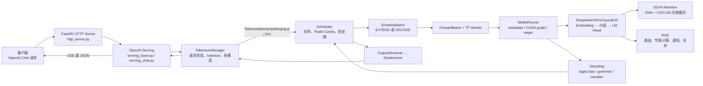
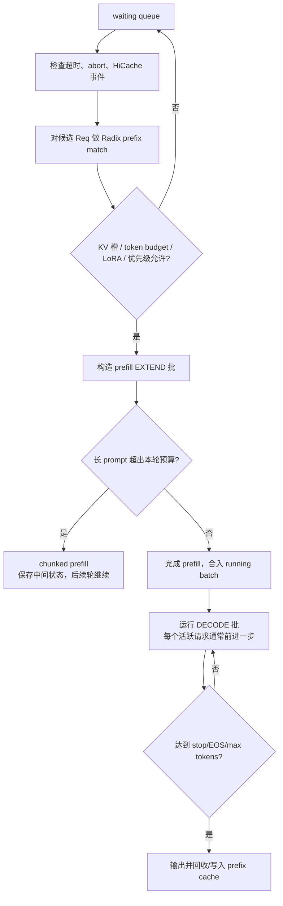
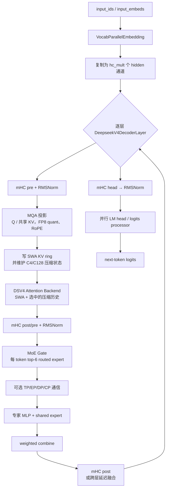
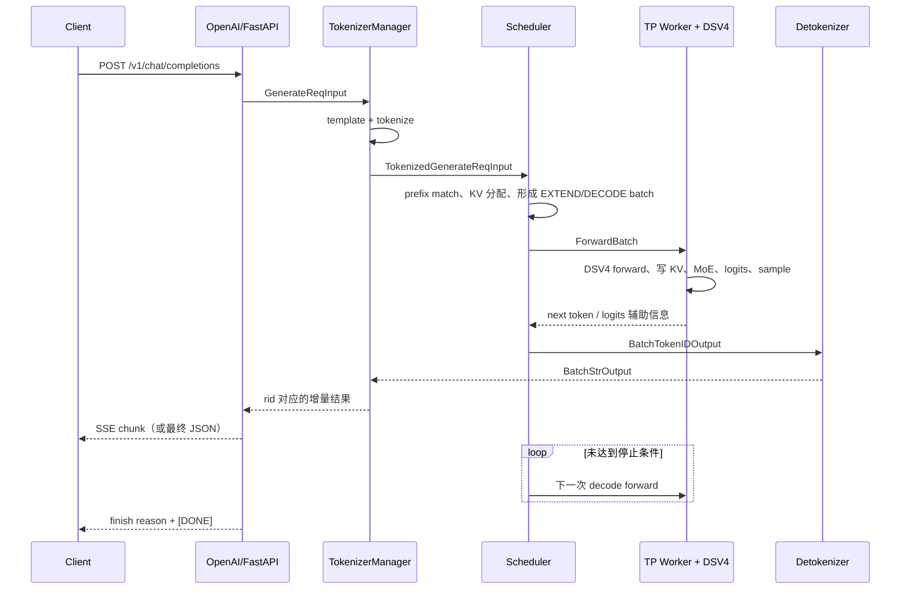

# DeepSeek V4 在 SGLang 中的请求端到端链路

> 本文以 OpenAI 兼容的 `POST /v1/chat/completions`、文本生成、单个 SGLang 服务实例为主线，追踪一条请求从 HTTP 到首 token、再到完成返回的代码路径。模型以当前仓库的 `DeepseekV4ForCausalLM` 为例。
> 源码基线：`main` 分支，提交 `ffc431cd4c`（2026-08-26）。本文是静态源码分析，不等同于某一套 GPU、量化格式、TP/EP/CP 拓扑上的性能实测。

## 1. 总览：一条请求经过的七个层次

SGLang 将“接入和文本处理”与“GPU 调度和模型执行”分开。HTTP 进程并不直接调用模型；它将规范化后的 token 请求经 IPC 交给 Scheduler。Scheduler 负责动态批处理、前缀缓存、KV 槽分配和 prefill/decode 切换，再通过 TP worker 与 ModelRunner 进入 DeepSeek V4 的注意力、压缩缓存和 MoE 计算。

从对象的角度看，数据依次演变为：

| 阶段 | 主要对象 | 代表内容 | 责任方 |
|---|---|---|---|
| API | `ChatCompletionRequest` | `messages`、`stream`、采样参数、tools | FastAPI/OpenAI adapter |
| 内部请求 | `GenerateReqInput` | 模板后的 prompt、stop、LoRA、优先级等 | `serving_chat.py` |
| 已分词请求 | `TokenizedGenerateReqInput` | `input_ids`、多模态特征、`SamplingParams`、rid | `tokenizer_manager.py` |
| 调度请求 | `Req` | 输出 token、prefix KV 索引、生命周期、完成状态 | `scheduler.py` |
| GPU 批 | `ScheduleBatch` → `ForwardBatch` | token、位置、长度、KV 写入槽、采样与并行元数据 | scheduler/TP worker |
| 模型结果 | `LogitsProcessorOutput`、`GenerationBatchResult` | logits、下一 token、logprobs、可选专家统计 | model runner |
| 返回对象 | `BatchStrOutput` / OpenAI SSE chunk | 解码文本、finish reason、usage、缓存信息 | detokenizer/API adapter |

## 2. 启动期：为何会走 DeepSeek V4 专用路径

模型配置中的 `architectures` 为 `DeepseekV4ForCausalLM` 时，参数覆盖注册表会选择 `dsv4` attention backend，并将 CUDA/XPU 的默认 page size 设为 256（NPU 为 128）；还会设置 DeepSeek V4 的 SWA full-token 比例和可选 MoE runner。入口见：

- `python/sglang/srt/arg_groups/overrides.py:1304`：`_deepseek_v4_overrides`。
- `python/sglang/srt/arg_groups/deepseek_v4_hook.py:104`：额外默认值、MegaMoE token budget 校验、CP 限制。
- `python/sglang/srt/configs/deepseek_v4.py:48`：模型结构配置；默认含 43 层、64 attention heads、单 KV head、每 token 选 6 个 routed experts、1 个 shared expert、`window_size=128`、`hc_mult=4`。

启动时还会创建 `DeepSeekV4TokenToKVPool`。它不是普通的 `[K,V]` KV pool：每层同时管理 SWA 原始环形缓存、C4/C128 压缩缓存、indexer 缓存以及压缩状态。`DeepSeekV4SingleKVPool` 将 non-RoPE 部分以 FP8、RoPE 部分以 BF16 并附带 scale 打包存储；相关实现位于 `python/sglang/srt/mem_cache/deepseek_v4_memory_pool.py:59`、`:463`。因此下面的 attention 不是“读取全量历史 K/V”，而是读取短窗口和压缩后的长历史。

### 2.1 启动期和运行期校验

- 使用 MegaMoE 时必须有正数 `--chunked-prefill-size`，且按 TP/DP/CP 分摊后的每 rank token 数不能超过 `SGLANG_OPT_DEEPGEMM_MEGA_MOE_NUM_MAX_TOKENS_PER_RANK`；否则直接报错或运行时退回其它 MoE 路径（`deepseek_v4_hook.py:15`）。
- DeepSeek V4 的 prefill CP 仅支持 `interleave` 策略；代码会切到 DSA prefill CP、round-robin split，要求 `dp_size == 1`、`tp_size <= 8`，并限制可用的 MoE A2A backend（`deepseek_v4_hook.py:160`）。
- DSV4 attention backend 对 speculative EAGLE top-k 限制为 `0` 或 `1`（`deepseek_v4_backend.py:600` 附近）。
- ROCm/HIP 上默认关闭 DeepSeek-V4-Flash 的 FlashMLA sparse prefill，因为源码明确标注该组合存在错误输出风险（`deepseek_v4_hook.py:118`）。这不是性能开关，而是正确性保护。

## 3. 接收、校验、模板化与分词

### 3.1 HTTP 与 OpenAI 协议适配

1. FastAPI 路由 `openai_v1_chat_completions` 接收 `ChatCompletionRequest`，调用 `openai_serving_chat.handle_request`（`python/sglang/srt/entrypoints/http_server.py:1722`）。
2. 基类 `OpenAIServingBase.handle_request` 做通用请求校验、原始请求日志、内部请求转换，并根据 `request.stream` 选择 streaming/non-streaming 返回（`entrypoints/openai/serving_base.py:73`）。无效请求在仍能返回 HTTP 状态码时转换为 OpenAI 风格错误。
3. `OpenAIServingChat._convert_to_internal_request` 与 `_process_messages` 完成消息规范化、chat template/Jinja 模板、system/user/assistant/tool 消息拼接、stop 条件、tools/reasoning parser 处理，并构造 `GenerateReqInput`（`entrypoints/openai/serving_chat.py:966`、`:1100`）。

这一步的产物仍主要是文本或用户传入的 token ids。DeepSeek V4 并不在 HTTP 层做特有矩阵计算；模型特有分流是在服务启动后的参数覆盖、KV pool 和 attention backend 中发生的。

### 3.2 TokenizerManager：文本变成可调度输入

`TokenizerManager.generate_request` 是 API 侧的异步总入口（`managers/tokenizer_manager.py:769`）：它规范化 batch 参数、创建 request state、检查 LoRA 与客户端取消状态，然后调用 `_tokenize_one_request`。

`_tokenize_one_request`（`tokenizer_manager.py:960`）的优先级为：

1. 已给定 `input_embeds`：要求关闭 radix cache，避免“同一 token id、不同 embedding”错误复用 KV；
2. 已给定 `input_ids`：跳过 tokenizer；
3. 普通文本：调用 tokenizer 得到 `input_ids`；
4. 多模态：如请求带图像/音视频，调用 `mm_processor`，将视觉/音频 embedding、替换位置和扩展后的 token ids 一并加入请求。

完成后，TokenizerManager 组装 `TokenizedGenerateReqInput`（`tokenizer_manager.py:1343` 附近），在 `_send_one_request` 中准备共享内存/特征传输并通过 `_dispatch_to_scheduler` 发往 Scheduler（`:1556`）。这里是 API 进程与调度/模型进程之间的边界。

## 4. Scheduler：前缀复用、准入、Prefill 与 Decode

### 4.1 请求入队与 prefix match

Scheduler 接收到 `TokenizedGenerateReqInput` 后，`process_input_requests` 分派给 `handle_generate_request`（`managers/scheduler.py:1923`、`:2431`）。后者构建 `Req`：保存 rid、原始 input ids、采样参数、流式标志、LoRA、缓存 salt/routing key 和各类返回开关。

调度器为待运行请求调用 `Req.init_next_round_input(tree_cache)`。该函数将 `origin_input_ids + output_ids` 组成当前完整序列，再以 `RadixKey` 查询 prefix cache（`managers/schedule_batch.py:1307`、`:1368`）。命中的 token 获得 `prefix_indices`，无需再次 prefill；未命中的后缀才会进入本次 extend。带 SWA 的布局会刻意保留尾部窗口重新 prefill，因为 SWA 是每请求的 ring buffer，不能直接把另一请求的 ring 状态当作内容稳定的 prefix 复用。

### 4.2 调度决策

`Scheduler.get_next_batch_to_run`（`scheduler.py:3095`）在每轮执行以下逻辑：

- `get_new_batch_prefill` 和 `_get_new_batch_prefill_raw` 在 token budget、KV 可用槽、优先级、LoRA、HiCache/存储预取就绪等约束下挑选请求（`scheduler.py:3240`）。
- `ScheduleBatch.prepare_for_extend` 计算 `prefix_lens`、`extend_lens`、`seq_lens`，把未命中 token 拉平成 pinned CPU tensor，并调用 `alloc_for_extend` 分配 `out_cache_loc` 和 request/KV 槽（`schedule_batch.py:2407`）。
- 之后 `ForwardBatch.init_new` 复制/引用该批的 input ids、位置、长度、KV 写入位置、sampling 信息和可选 speculative 信息（`model_executor/forward_batch_info.py:709`）。

**Prefill 与 decode 的差异**：prefill 的 `EXTEND` 一次计算每个请求的一段新 token，计算量与新 token 数成正比；decode 使用已缓存的 KV，每个活跃序列通常只新增一个 token。前缀命中只减少 prefill 后缀，不会跳过后续 decode。

## 5. 从 ForwardBatch 到模型前向

`Scheduler.run_batch` 选择模型 worker 执行，且会根据配置启用 schedule/forward/copy stream overlap（`scheduler.py:3723`）。非 speculative 的主路径可概括为：

1. `TpModelWorker.forward_batch_generation` 将 `ScheduleBatch` 变成 `ForwardBatch`（`managers/tp_worker.py:583`）；最后一个 PP stage 才采样 token，前面的 PP stage 只传递 hidden states。
2. `ModelRunner.forward` 包装 profiling、expert distribution recorder、弹性 EP 等上下文（`model_executor/model_runner.py:1541`）。
3. `ModelRunner._forward_raw` 先判断是否可 replay decode CUDA graph，随后为 eager/prefill graph 准备 attention metadata；不能图执行时进入 `EagerRunner`（`model_runner.py:1685`）。
4. `EagerRunner.execute` 按 `ForwardMode` 分为 decode、idle、extend；在真正调用模型前执行 `attn_backend.init_forward_metadata(forward_batch)`（`model_executor/runner/eager_runner.py:204`）。
5. `EagerRunner._execute_decode/_execute_extend` 最终调用 `model_runner.model.forward(input_ids, positions, forward_batch, ...)`。对 DeepSeek V4，这个对象就是 `DeepseekV4ForCausalLM`。

`dsv4` backend 在 metadata 初始化期间生成 DSV4 的 page table、SWA page indices、C4/C128 compression metadata 和可选 indexer metadata。`DSV4AttnMetadata.init_compression_metadata` 为压缩页建立写入位置和索引；`init_flashmla_related` 会把 C4 top-k 限制在模型配置允许的 512 或 1024（`layers/attention/deepseek_v4_backend.py:280`、`:724`）。

## 6. DeepSeek V4 模型前向：Embedding → mHC/Attention → MoE → Logits

### 6.1 模型级路径

`DeepseekV4ForCausalLM.forward`（`models/deepseek_v4.py:3318`）先在需要时准备 DSA prefill CP metadata；调用 `self.model.forward`；最后一个 PP stage 才把 hidden states 交给 `logits_processor` 与 `lm_head`。`DeepseekV4Model.forward`（`:3052`）的核心流程如下：

模型在第一个 PP stage 以 `VocabParallelEmbedding` 产生 embedding，并 `unsqueeze/repeat` 为 `hc_mult` 路 hidden states；非首 PP stage 从 `PPProxyTensors` 恢复 hidden states。模型逐层遍历 `DeepseekV4DecoderLayer`，最后一个 PP stage 执行 mHC head、RMSNorm；非最后 PP stage 把张量拍平后经 PP IPC 传到下一 stage（`models/deepseek_v4.py:2707`、`:3052`、`:3160`）。

### 6.2 一个 Decoder Layer 的计算语义

`DeepseekV4DecoderLayer.forward` 位于 `models/deepseek_v4.py:2041`。单层不是传统的“RMSNorm → Attention → residual → RMSNorm → MLP”直线结构，而是在多 hidden channels（mHC）之间计算 mixing：

1. **mHC pre**：根据前一层 residual 与 post/combine 状态产生本层输入；可使用跨层 `apply_mhc_post_pre_boundary` 融合。若融合 kernel 不适用，显式完成前层 post 再执行本层 pre，保证不会丢失 residual。
2. **输入归一化与 Attention**：应用 `input_layernorm`（部分平台会 fused RMSNorm+FP8 quant），进入 `self.self_attn`。
3. **mHC post/pre 与 MoE 前归一化**：attention 输出先与 residual/mHC 状态合并，经过 `post_attention_layernorm`。
4. **MoE FFN**：`_run_moe_ffn_dp_sync` 执行 gate、专家分发、专家 MLP、通信和 weighted combine；并根据 DP/EP/CP/A2A backend 选择同步方式。
5. **mHC post**：普通模式立即完成；启用跨层融合时把 post state 延迟给下一层消费，最后一层由 `DeepseekV4Model` 收尾。

所以 mHC、MoE 通信与 attention cache 都是 DeepSeek V4 关键路径的一部分。只看 `self_attn` 并不能代表该模型的完整单层成本。

### 6.3 MQA、SWA 与 C4/C128 压缩注意力

`MQALayer.forward`（`models/deepseek_v4.py:1531`）准备 Q 和共享 KV：它会做 Q/KV 投影、RMSNorm、RoPE，并在可用时融合“norm + RoPE + KV store”以减少中间张量和 kernel launch。随后调用 `DeepseekV4AttnBackend.forward`。

该 backend 的真实读写路径在 `layers/attention/deepseek_v4_backend.py:1589`：

- `store_cache` 按 `out_cache_loc` 把当前 token 的共享 KV 写入本层 SWA ring；
- 始终读取 SWA 窗口；
- `compress_ratio=0` 时没有额外压缩历史，`4` 或 `128` 时取 C4/C128 的压缩 key buffer 与 page indices；
- 根据 prefill/decode、硬件和环境变量选择 `flash_mla_sparse_fwd` 或 `flash_mla_with_kvcache`；
- 为 kernel 约束，SWA 与额外 index 的最后维必须 64 对齐。

这解释了 DeepSeek V4 的长上下文思路：近期信息保留高保真 SWA，较久历史通过压缩路径参与稀疏/压缩 attention；不是每一步对全部原始 KV 做密集注意力。压缩的 C4/C128 state 由 `DeepSeekV4TokenToKVPool` 与 `layers/attention/dsv4/compressor.py` 管理。

### 6.4 并行与性能分支何时发生

- **TP/PP**：embedding、线性层和 LM head 可按 TP 切分；PP 中间 stage 用 `PPProxyTensors` 传 hidden states。只有最后 PP rank 获得 logits 并采样。
- **EP/MoE A2A**：gate 选出的 token 需要按 expert owner 分发；`_run_moe_ffn_dp_sync` 选择 DeepEP、MegaMoE 或其它可用实现。实际通信方式由启动参数和硬件决定。
- **Prefill CP**：DeepSeek V4 会将 token/position 做 round-robin 重排，层完成后在最后 PP rank all-gather 并恢复顺序（`models/deepseek_v4.py:3052` 之后）。CP 只在满足启动校验时启用。
- **CUDA graph / prefill graph / eager**：ModelRunner 根据 forward mode、batch shape 和 graph runner 能力决定。图 replay 是优化分支，不改变模型语义；不满足条件自动回到 eager。
- **TBO/MTP/DSpark**：two-batch overlap 仅在特定 prefill、PP、CP/硬件条件成立时使用；EAGLE/DSpark 会替换“单次 forward 后直接 sample”的循环，但仍复用 DSV4 target backend 的核心模型与缓存语义。

## 7. Logits、采样、结果回传与 HTTP 响应

### 7.1 从 logits 到下一轮输入

模型最后由 `logits_processor` 产出 `LogitsProcessorOutput`。在最后 PP rank，`TpModelWorker.forward_batch_generation` 调用 `ModelRunner.sample`，应用 grammar/vocab mask、logits bias、penalty，并由 sampler 产生 next token id（`managers/tp_worker.py:583`、`model_executor/model_runner.py:1800`）。

Scheduler 将该 token 作为下一轮 `RelayPayload`，下一轮 decode 用它与已有 KV 继续前向；同时 `process_batch_result` 根据 EXTEND/DECODE 分支更新请求状态、缓存、指标与完成原因（`managers/scheduler.py:4047`）。停止条件可来自 EOS、用户 stop string、max new tokens、grammar 或 abort；只有未完成请求会重新留在 running batch。

### 7.2 Detokenize 与流式返回

GPU 输出不能直接作为 HTTP 文本返回。Scheduler 的 batch result processor 经 `OutputStreamer` 把 token 输出发送到 detokenizer；`DetokenizerManager` 把增量 token ids 解码为文本并返回 TokenizerManager。TokenizerManager 的 `_handle_batch_output` 将每个 rid 的文本、prompt/completion/cached token 数、finish reason、logprobs、时间统计等写入对应 `ReqState`（`managers/tokenizer_manager.py:2170`）。

随后：

- streaming：`OpenAIServingChat._generate_chat_stream` 消费 `TokenizerManager.generate_request` 的异步结果，处理 tool-call/reasoning/logprobs，逐段封装为 SSE `data: {...}`，完成时发送 finish chunk 与 `data: [DONE]`（`entrypoints/openai/serving_chat.py:1543`）；
- non-streaming：`_handle_non_streaming_request` 等待首个完整结果，`_build_chat_response` 组装 OpenAI JSON（`serving_chat.py:1809`）。

## 8. 读代码时的最短导航表

| 想回答的问题 | 首选文件与入口 |
|---|---|
| HTTP endpoint 如何进来？ | `entrypoints/http_server.py:1722` |
| OpenAI messages 如何变成内部 prompt？ | `entrypoints/openai/serving_base.py:73`；`serving_chat.py:966`、`:1100` |
| 如何 tokenize、发给 Scheduler、等待输出？ | `managers/tokenizer_manager.py:769`、`:960`、`:1556`、`:1689`、`:2170` |
| 如何创建请求、做 cache match、形成 prefill/decode batch？ | `managers/scheduler.py:2431`、`:3095`、`:3240`；`managers/schedule_batch.py:1307`、`:2407` |
| GPU batch 中有哪些张量？ | `model_executor/forward_batch_info.py:709` |
| 如何选择 graph/eager 并真正调用 model？ | `model_executor/model_runner.py:1541`、`:1685`；`runner/eager_runner.py:204` |
| DeepSeek V4 主模型和单层计算？ | `models/deepseek_v4.py:2041`、`:2707`、`:3052`、`:3318` |
| DSV4 attention 的 metadata、KV 写入与 kernel dispatch？ | `layers/attention/deepseek_v4_backend.py:724`、`:1589`、`:1599` |
| V4 的专用缓存如何组织？ | `mem_cache/deepseek_v4_memory_pool.py:59`、`:463` |
| 何种参数组合会被 V4 拒绝或改写？ | `arg_groups/deepseek_v4_hook.py:15`、`:104`、`:160`；`arg_groups/overrides.py:1304` |

## 9. 结论与边界

一条 DeepSeek V4 请求的关键不是“HTTP 调用一次 model.forward”这么简单，而是：先通过模板化和 tokenizer 获得稳定 token 序列；Scheduler 用 radix prefix match 缩短实际 prefill，并为未命中后缀分配 DSV4 专用 KV/压缩状态；ModelRunner 为 batch 建 metadata 后调用 mHC + MQA + SWA/C4/C128 attention + MoE 的模型前向；采样 token 被回灌到下一轮 decode，直到完成；最后 token 经 detokenizer 和 OpenAI adapter 才成为客户端看到的 SSE 或 JSON。

本文的主线刻意不把 P/D disaggregation、HiCache L2/L3、HiSparse、MTP/DSpark、NPU/ROCm 专用 backend 展开成另一条“默认必经”路径：它们都是条件分支。启用这些特性时，应该从第 8 节导航表跳到相应 hook/backend，再按实际启动参数判断，不能把某个优化分支当成所有 DeepSeek V4 请求都会执行的路径。
