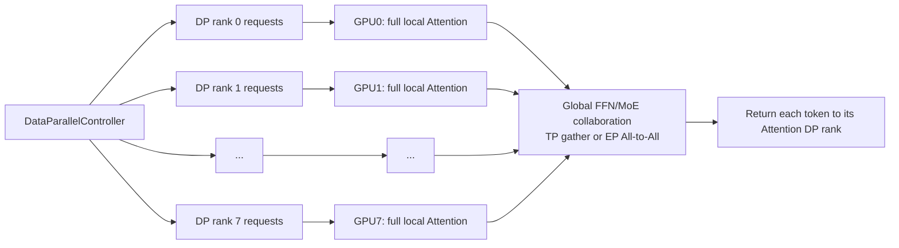
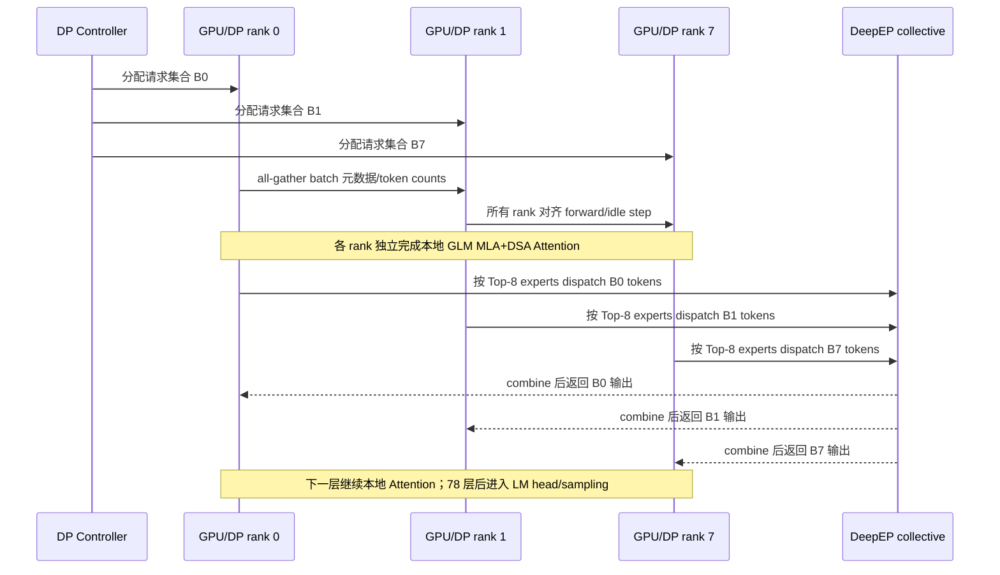

# SGLang `--dp 8 --enable-dp-attention` 工作原理：以 GLM-5.2 为例

> 代码基线：SGLang commit `a2e88279c28c16945c7c7eacb27f1e066b670a41`（2026-08-11）
>
> 本文讨论推理服务中的 DP Attention，不是训练中的梯度 Data Parallel。
>
> 典型命令上下文是 `--tp 8 --dp 8 --enable-dp-attention`；只写 `--dp 8` 而没有 `--tp 8`，含义和资源规模完全不同。

### 源码片段阅读约定

本文每个关键机制后都给出“对应源码”。链接指向当前仓库中的真实文件和起始行；代码块为了突出控制流，会省略日志、异常处理、低频 backend 分支或与当前结论无关的参数，并用 `...` 标记。阅读完整实现时应点击代码块上方的文件链接，不能把精简片段直接复制为可运行程序。

## 1. 先解释命令：这实际上是两个选项，不是三个独立功能

用户经常看到这样的 shell 片段：

```bash
--dp 8 \
--enable-dp-attention
```

其中：

- `--dp` 是 `dp_size` 的 CLI 名称；
- `8` 是 `--dp` 的参数值；
- `--enable-dp-attention` 是一个布尔开关；
- 行尾的 `\` 只是 shell 的换行续写符，不是 SGLang 参数。

参数定义位于 [`python/sglang/srt/server_args.py`](../python/sglang/srt/server_args.py#L1033) 和同文件的 [DP Attention 参数段](../python/sglang/srt/server_args.py#L1139)。`--dp-size`、`--data-parallel-size` 也是 `dp_size` 的兼容写法。

**对应源码：** [`python/sglang/srt/server_args.py`](../python/sglang/srt/server_args.py#L1033) — `ServerArgs.dp_size` 和 `ServerArgs.enable_dp_attention`：

```python
dp_size: A[
    int,
    Arg(
        help="The data parallelism size.",
        aliases=["--data-parallel-size"],
    ),
    NS("parallel"),
] = 1

# DP attention
enable_dp_attention: A[
    bool,
    Arg(
        help=(
            "Enabling data parallelism for attention and tensor "
            "parallelism for FFN. The dp size should be equal to "
            "the tp size."
        ),
        resolvable=True,
    ),
    NS("parallel"),
] = False
```

这里的 `dp_size` 只声明并行度；真正决定它是“完整模型副本数”还是“Attention DP 维度”的是 `enable_dp_attention`。所以分析部署命令时不能只看 `--dp 8`，必须与 `--tp`、`--enable-dp-attention` 一起看。

最重要的结论是：

```text
--dp 8                              8 套相互独立的模型副本
--tp 8 --dp 8                      通常需要 8 × 8 = 64 张 GPU

--tp 8 --dp 8 --enable-dp-attention
                                    DP 维度嵌入原有 TP=8 world
                                    总模型 worker 仍是 8 张 GPU，而不是 64 张
```

第二种模式不是“复制 8 套完整的 TP8 模型”。它把同一个 8-GPU world 按层重新解释：Attention 按 DP 划分请求，而 FFN/MoE 仍可按 TP 或 EP 跨卡协作。这也是 SGLang 参数帮助中“data parallelism for attention and tensor parallelism for FFN”的真实含义。

## 2. 为什么需要 DP Attention

大规模 MoE 模型存在一个结构性不对称：

- Attention 参数量相对较小，但每个请求有独立 KV Cache，decode 时每步 query 很少，TP 切得过细后容易被通信和小 GEMM 开销主导；
- MoE/FFN 权重极大，单卡放不下，必须继续在多卡之间切分专家或矩阵；
- 不同请求的 Attention 天然相互独立，适合按请求/批次做 DP；
- 同一个 token 的 Top-K 专家可能分布在不同 GPU，MoE 适合用 EP All-to-All 或 TP 协作。

DP Attention 因此采用“Attention DP、MoE TP/EP”的混合策略：



它不是把一条序列沿 token 维度切到 8 卡。单条请求的完整 Attention、KV Cache 和 DSA index cache 属于一个 Attention DP rank。沿长序列拆分 KV/Attention 是 CP/DCP 解决的问题，不能与这里的 DP 混为一谈。

## 3. `--dp` 单独使用与开启 DP Attention 的本质区别

### 3.1 普通服务 DP：复制整个模型实例

当 `dp_size > 1` 且没有开启 DP Attention 时，[`DataParallelController`](../python/sglang/srt/managers/data_parallel_controller.py#L132) 会调用 [`launch_dp_schedulers`](../python/sglang/srt/managers/data_parallel_controller.py#L364)：

1. 建立 `dp_size` 套独立 worker；
2. 每套 worker 都有自己的 TP×PP GPU 集合；
3. Controller 按 round-robin、请求数或 token 数把请求分配给某套副本；
4. 不同副本之间不为模型前向做 collective。

若配置为 TP=8、DP=8、PP=1，则 GPU 数是：

```text
world_size = TP × DP × PP = 8 × 8 × 1 = 64
```

每个 DP replica 都能独立运行，某个 replica 空闲时不需要陪其他 replica 进入 MoE collective。

**对应源码：** [`python/sglang/srt/managers/data_parallel_controller.py`](../python/sglang/srt/managers/data_parallel_controller.py#L364) — 普通 DP 为每个 `dp_rank` 启动一套 TP group，并递增 `base_gpu_id`：

```python
def launch_dp_schedulers(self, server_args, port_args):
    base_gpu_id = 0

    threads = []
    for dp_rank in range(server_args.dp_size):
        thread = threading.Thread(
            target=self.launch_tensor_parallel_group_thread,
            args=(server_args, tmp_port_args, base_gpu_id, dp_rank, ready_event),
        )
        threads.append(thread)

        # 下一份 DP replica 从下一组 TP×PP GPU 开始。
        base_gpu_id += (
            server_args.tp_size
            * server_args.pp_size
            * server_args.gpu_id_step
        )
```

这段 `base_gpu_id += tp_size * pp_size` 是普通 DP 需要把 GPU 数量再乘 `dp_size` 的直接代码证据。

### 3.2 DP Attention：在同一个 TP world 内重排并行维度

开启 `--enable-dp-attention` 后，Controller 改走 [`launch_dp_attention_schedulers`](../python/sglang/srt/managers/data_parallel_controller.py#L546)：

1. 只启动原本的 TP×PP world；
2. TP ranks 被进一步解释为 Attention DP、Attention CP、Attention TP；
3. 不同 Attention DP rank 接收不同请求；
4. 到 FFN/MoE 边界时，这些 rank 仍属于同一个全局 TP/EP world，需要同步和通信。

因此 TP=8、DP=8、PP=1 时：

```text
worker GPU 数 = TP × PP = 8
Attention DP groups = 8
每个 Attention DP group 的 Attention TP size = 1
```

这是用更紧密的跨层协作换取 8 份并发 Attention，不是 8 套完全独立、可以各走各的模型实例。

**对应源码：** [`python/sglang/srt/managers/data_parallel_controller.py`](../python/sglang/srt/managers/data_parallel_controller.py#L199) — Controller 在这里选择两种完全不同的启动路径：

```python
if server_args.enable_dp_attention:
    self.launch_dp_attention_schedulers(server_args, port_args)
else:
    self.launch_dp_schedulers(server_args, port_args)
```

DP Attention 路径最终只调用一次 `launch_tensor_parallel_group`：

```python
def launch_dp_attention_schedulers(self, server_args, port_args):
    # 为各 Attention DP rank 准备请求端口，随后复用同一个 TP world。
    ...
    self.launch_tensor_parallel_group(
        server_args, port_args, 0, None, broadcasted_ports
    )
```

而 [`Engine._launch_scheduler_processes`](../python/sglang/srt/entrypoints/engine.py#L848) 只要看到 `dp_size > 1`，就先创建 Controller：

```python
use_dp_controller = (
    server_args.dp_size > 1 or server_args.ep_join_mode == "scale"
)

if not use_dp_controller:
    # 直接启动 TP scheduler processes
    ...
else:
    # 先启动 DataParallelController，由它再组织普通 DP 或 DP Attention。
    proc = mp.Process(
        target=run_data_parallel_controller_process,
        kwargs=dict(
            server_args=server_args,
            port_args=port_args,
            pipe_writer=writer,
            run_scheduler_process_func=run_scheduler_process_func,
        ),
    )
```

## 4. 并行维度和 rank 公式

核心公式位于 [`compute_dp_attention_world_info`](../python/sglang/srt/layers/dp_attention.py#L321)：

```text
attn_dp_size = dp_size                         # 开启 DP Attention 时
attn_tp_size = tp_size / attn_dp_size / attn_cp_size
attn_tp_rank = tp_rank % attn_tp_size
attn_dp_rank = tp_rank / (attn_tp_size × attn_cp_size)
```

rank 布局为：

```text
tp_rank = (attn_dp_rank × attn_cp_size + attn_cp_rank)
          × attn_tp_size + attn_tp_rank
```

**对应源码：** [`python/sglang/srt/layers/dp_attention.py`](../python/sglang/srt/layers/dp_attention.py#L321) — 下面就是上述公式的实际实现：

```python
def compute_dp_attention_world_info(
    enable_dp_attention, tp_rank, tp_size, dp_size, attn_cp_size: int = 1
):
    attn_dp_size = dp_size if enable_dp_attention else 1
    attn_tp_size = tp_size // attn_dp_size // attn_cp_size
    attn_tp_rank = tp_rank % attn_tp_size

    if not enable_dp_attention:
        attn_dp_rank = 0
    else:
        # Rank layout is (dp, cp, tp), tp 是变化最快的维度。
        attn_dp_rank = tp_rank // (attn_tp_size * attn_cp_size)

    return attn_tp_rank, attn_tp_size, attn_dp_rank, attn_dp_size
```

[`initialize_dp_attention`](../python/sglang/srt/layers/dp_attention.py#L338) 再把计算结果写入运行时状态，后续 Attention、scheduler 和 buffer 代码都从这里读取本 rank 的 DP 身份：

```python
tp_rank = get_tensor_model_parallel_rank()
tp_size = get_tensor_model_parallel_world_size()

_, _, _ATTN_DP_RANK, _ = compute_dp_attention_world_info(
    enable_dp_attention, tp_rank, tp_size, dp_size, attn_cp_size
)
_ATTN_DP_SIZE = dp_size if enable_dp_attention else 1
```

当前参数检查要求 `tp_size` 能被 `dp_size × attn_cp_size` 整除。虽然代码能够表达 `TP=8, DP=2, Attention-TP=4` 这种混合布局，但模型和具体 kernel/backend 可能有更严格限制。GLM-5.2 的仓库示例和 E2E 测试采用最清晰、验证最充分的 `TP=DP` 配置。

### 4.1 TP8、DP8 的具体 rank 表

假设 `attn_cp_size=1`：

| global/TP rank | Attention DP rank | Attention TP rank | Attention TP size | 本地请求集合 |
|---:|---:|---:|---:|---|
| 0 | 0 | 0 | 1 | DP0 的请求 |
| 1 | 1 | 0 | 1 | DP1 的请求 |
| 2 | 2 | 0 | 1 | DP2 的请求 |
| 3 | 3 | 0 | 1 | DP3 的请求 |
| 4 | 4 | 0 | 1 | DP4 的请求 |
| 5 | 5 | 0 | 1 | DP5 的请求 |
| 6 | 6 | 0 | 1 | DP6 的请求 |
| 7 | 7 | 0 | 1 | DP7 的请求 |

[`initialize_model_parallel`](../python/sglang/srt/distributed/parallel_state.py#L2285) 据此建立多组 communicator：

- `_TP`：完整 8-rank world；
- `_ATTN_TP`：每个 Attention DP group 内的 Attention TP group，本例 size=1；
- `_ATTN_CP`：Attention context-parallel group，本例 size=1；
- `_MOE_EP`：专家并行 group；
- `_MOE_TP`：MoE tensor-parallel group；
- `_MOE_DP`：MoE data-parallel group。

Attention 和 MoE 使用不同的 group 切法，是整个方案的基础。

**对应源码：** [`python/sglang/srt/distributed/parallel_state.py`](../python/sglang/srt/distributed/parallel_state.py#L2451) — Attention 和 MoE 的 group size 分别计算：

```python
attn_dp_size = attention_data_parallel_size
attn_cp_size = attention_context_model_parallel_size
attn_tp_size = tensor_model_parallel_size // attn_cp_size // attn_dp_size

# 每个 (DP, CP) 子空间建立自己的 Attention-TP group。
for cp_dp_combined_idx in range(attn_cp_size * attn_dp_size):
    st = (
        tp_group_idx * tensor_model_parallel_size
        + cp_dp_combined_idx * attn_tp_size
    )
    en = st + attn_tp_size
    ranks = list(range(st, en))
    group_ranks.append(ranks)

moe_ep_size = expert_model_parallel_size
moe_dp_size = moe_data_model_parallel_size
moe_tp_size = tensor_model_parallel_size // moe_ep_size // moe_dp_size
```

这解释了为什么同一个 `tp_rank` 同时拥有 `attn_dp_rank`、`attn_tp_rank`、`moe_ep_rank` 和 `moe_tp_rank`：它在 Attention 层与 MoE 层进入的 communicator 并不相同。

### 4.2 MoE 维度公式

MoE 侧使用：

```text
moe_tp_size = tp_size / moe_ep_size / moe_dp_size
```

在 GLM-5.2 TP8/DP8 中有两种重要情况：

| 配置 | `moe_ep_size` | `moe_tp_size` | 稀疏 MoE 的工作方式 |
|---|---:|---:|---|
| `--moe-a2a-backend none` | 1 | 8 | 所有 DP token gather 后，由 8 卡 TP 协作计算专家 |
| `--moe-a2a-backend deepep` | 自动调整为 8 | 1 | 每卡拥有一部分专家；token 通过 All-to-All 发往专家所在卡 |

A2A 后端自动把 `ep_size` 调整为 `tp_size`，代码见 [`_a2a_ep_size`](../python/sglang/srt/arg_groups/overrides.py#L2568)。这就是 GLM-5.2 吞吐配置常同时出现下面几项的原因：

```bash
--tp 8 \
--dp 8 \
--enable-dp-attention \
--moe-a2a-backend deepep
```

**对应源码：** [`python/sglang/srt/arg_groups/overrides.py`](../python/sglang/srt/arg_groups/overrides.py#L2568) — 只要选择跨 TP world 的 A2A backend，就把 EP 扩展到完整 TP size：

```python
@register_post_process
def _a2a_ep_size(view: Any) -> dict:
    if view.moe_a2a_backend in _A2A_EP_SPANNING_BACKENDS:
        if view.ep_size != view.tp_size:
            logger.info(
                f"{view.moe_a2a_backend} MoE is enabled. "
                f"The expert parallel size is adjusted from {view.ep_size} "
                f"to the tensor parallel size [{view.tp_size}]."
            )
        return {"ep_size": view.tp_size}
    return {}
```

## 5. 服务进程和请求调度架构

### 5.1 Engine 与 Controller

[`Engine._launch_scheduler_processes`](../python/sglang/srt/entrypoints/engine.py#L832) 发现 `dp_size > 1` 后先启动 `DataParallelController`。Controller 的职责不是执行 GPU kernel，而是：

- 为每个 DP rank 建立输入通道；
- 按 `--load-balance-method` 选择目标 DP rank；
- 把普通生成请求只发给一个 Attention DP group；
- 把需要全局一致的控制消息发到所有相关 worker；
- 收集各 worker 的启动状态和负载信息。

普通 DP 会启动多套 TP group；DP Attention 则调用一次 `launch_tensor_parallel_group`，在同一组 TP ranks 内为每个 Attention DP leader 配置独立请求端口。

**对应源码：** [`python/sglang/srt/managers/data_parallel_controller.py`](../python/sglang/srt/managers/data_parallel_controller.py#L636) — 启动每个 TP rank 时，先计算它属于哪个 Attention DP rank，并让所有 ranks 复用同一个 NCCL 初始化端口：

```python
if server_args.enable_dp_attention:
    _, _, dp_rank, _ = compute_dp_attention_world_info(
        server_args.enable_dp_attention,
        tp_rank,
        server_args.tp_size,
        server_args.dp_size,
        server_args.attn_cp_size,
    )
    rank_port_args = PortArgs.init_new(
        server_args, dp_rank, worker_ports
    )

    # Data parallelism reuses the tensor parallelism group,
    # so all dp ranks should use the same nccl port.
    rank_port_args.nccl_port = port_args.nccl_port

attn_dp_size = (
    server_args.dp_size if server_args.enable_dp_attention else 1
)
attn_tp_size = (
    server_args.tp_size // attn_dp_size // server_args.attn_cp_size
)
attn_cp_rank = (tp_rank // attn_tp_size) % server_args.attn_cp_size
```

`PortArgs.init_new(..., dp_rank, worker_ports)` 为不同 DP leader 准备不同请求入口；相同 `nccl_port` 则说明这些进程仍要加入同一个模型 collective world。

### 5.2 请求只在本 Attention group 内广播

请求接收与广播逻辑在 [`request_receiver.py`](../python/sglang/srt/managers/scheduler_components/request_receiver.py#L140)：

- 每个 DP group 的 leader 接收分配给自己的请求；
- 若 `attn_tp_size > 1`，只在本 `_ATTN_TP` group 内广播工作请求；
- 若启用 Attention CP，再在本 `_ATTN_CP` group 内广播；
- 工作请求不会广播到其他 Attention DP groups。

TP8/DP8 时 `attn_tp_size=1`，每张 GPU 自己就是一个 group，无需为工作请求做 Attention-TP CPU broadcast。

**对应源码：** [`python/sglang/srt/managers/scheduler_components/request_receiver.py`](../python/sglang/srt/managers/scheduler_components/request_receiver.py#L154) — 工作请求只在本 Attention-TP/CP group 内广播：

```python
def _broadcast_reqs_across_ranks(self, recv_reqs):
    if get_parallel().enable_dp_attention:
        if self.ps.attn_tp_rank == 0 and self.ps.attn_cp_rank == 0:
            work_reqs, control_reqs = self._split_work_and_control_reqs(recv_reqs)
        else:
            work_reqs = None
            control_reqs = None

        if self.ps.attn_tp_size != 1:
            work_reqs = broadcast_pyobj(
                work_reqs,
                self.attn_tp_group.rank,
                self.attn_tp_cpu_group,
                src=self.attn_tp_group.ranks[0],
            )

        if self.ps.attn_cp_size != 1:
            work_reqs = broadcast_pyobj(
                work_reqs,
                self.attn_cp_group.rank,
                self.attn_cp_cpu_group,
                src=self.attn_cp_group.ranks[0],
            )
```

代码没有把 `work_reqs` 广播到完整 `tp_group`，所以 DP0 的生成请求不会进入 DP1 的 Attention/KV Cache。

### 5.3 为什么不同 DP rank 仍需要同步 step

不同 DP ranks 可以拥有不同请求和不同本地 batch，但它们在 FFN/MoE 层会进入同一个 TP collective 或 EP All-to-All。collective 的调用次序必须一致，否则某张卡已经进入下一层、另一张卡仍在上一层时会死锁。

[`prepare_mlp_sync_batch_raw`](../python/sglang/srt/managers/scheduler_components/dp_attn.py#L224) 会在模型前向前交换以下元数据：

- 每个 Attention DP rank 的 token 数；
- 本地是 decode、extend/prefill、verify 还是 idle；
- 是否能运行 decode/prefill CUDA Graph；
- 是否可以启用 two-batch overlap；
- logprob 所需 token 数。

如果某个 DP rank 暂时没有请求、但其他 rank 需要运行，它会构造 `ForwardMode.IDLE` batch，仍按相同层序进入必要的 collective。Idle rank 不做真实 Attention/KV 更新，但不能跳过其他 rank 正在等待的 MoE 通信。

这意味着 DP Attention 的各 DP rank 是“请求独立、collective 步调协同”，而普通 DP replica 才是完整的前向独立。

**对应源码一：** [`python/sglang/srt/managers/scheduler_components/dp_attn.py`](../python/sglang/srt/managers/scheduler_components/dp_attn.py#L80) — 每个 rank 把本地执行信息编码为固定宽度 tensor：

```python
def _get_local_tensor(self, device, dtype=torch.int64) -> torch.Tensor:
    return torch.tensor(
        [
            self.num_tokens,
            self.num_tokens_for_logprob,
            int(self.can_run_decode_cuda_graph),
            int(self.is_extend_in_batch),
            int(self.local_can_run_tbo),
            self.local_forward_mode,
            int(self.can_run_prefill_cuda_graph),
        ],
        device=device,
        dtype=dtype,
    )
```

随后所有 ranks 对该元数据执行 all-gather，并从每个 DP group 的 leader 行提取全局 token 数和图执行条件：

```python
torch.distributed.all_gather_into_tensor(
    global_info_tensor.flatten(),
    local_info_tensor,
    group=group,
)

tp0_info_cpu = global_info_tensor.cpu()[:, 0, :]
self.global_num_tokens = tp0_info_cpu[:, 0].tolist()
self.global_num_tokens_for_logprob = tp0_info_cpu[:, 1].tolist()
self.can_run_decode_cuda_graph = bool(tp0_info_cpu[:, 2].min())
self.is_extend_in_batch = bool(tp0_info_cpu[:, 3].max())
```

`min()` 表示只要一个参与 rank 不能使用该 CUDA Graph，大家就不能选择不兼容的执行形状；`max()` 表示任意 rank 出现 extend 时，全局都要知道这一事实。

**对应源码二：** 同文件 [`prepare_mlp_sync_batch_raw`](../python/sglang/srt/managers/scheduler_components/dp_attn.py#L350) — 没有本地工作时构造 idle batch：

```python
if skip_all_gather:
    need_idle_batch = not dwdp and dp_size > 1
else:
    need_idle_batch = max(mlp_sync_info.global_num_tokens) > 0

batch_to_gather = local_batch
if need_idle_batch:
    if local_batch is None:
        batch_to_gather = local_batch = get_idle_batch()
    elif local_batch.forward_mode.is_prebuilt():
        batch_to_gather = local_batch.inner_idle_batch = get_idle_batch()
```

对应的枚举注释也明确了用途，见 [`python/sglang/srt/model_executor/forward_batch_info.py`](../python/sglang/srt/model_executor/forward_batch_info.py#L103)：

```python
class ForwardMode(IntEnum):
    ...
    # No sequence to forward. For data parallel attention,
    # some workers will be IDLE if no sequence are allocated.
    IDLE = auto()
```

## 6. 一层 Transformer 中数据怎样流动

SGLang 用 [`ScatterMode`](../python/sglang/srt/layers/communicator.py#L197) 描述 token 张量当前的分布状态：

| 模式 | 含义 |
|---|---|
| `SCATTERED` | 每个 rank 只持有自己切片的 token |
| `TP_ATTN_FULL` | 本 Attention-TP group 内每卡持有该 DP group 的完整 token |
| `FULL` | 全局 TP/MoE 计算所需的全部 DP token 已聚合 |
| `MOE_FULL` | 在特定 MoE/CP group 范围内聚合完整 |

[`LayerScatterModes`](../python/sglang/srt/layers/communicator.py#L360) 根据当前层是 dense FFN 还是 sparse MoE、是否启用 A2A、前后层类型等，决定 Attention 和 MLP 边界的模式转换。[`LayerCommunicator`](../python/sglang/srt/layers/communicator.py#L448) 真正执行 all-gather、all-reduce、reduce-scatter、局部 slice、residual add 和 RMSNorm。

**对应源码一：** [`python/sglang/srt/layers/communicator.py`](../python/sglang/srt/layers/communicator.py#L197) — 源码注释本身就给出了 TP4/DP2 的张量示例：

```python
class ScatterMode(Enum):
    """
    Suppose TP=4, DP=2 and the system handles seq a,b,c,d:
    Model input/output: [ab, ab, cd, cd]
    SCATTERED:          [a, b, c, d]
    TP_ATTN_FULL:       [ab, ab, cd, cd]
    FULL:               [abcd, abcd, abcd, abcd]
    """

    SCATTERED = auto()
    TP_ATTN_FULL = auto()
    FULL = auto()
    MOE_FULL = auto()
```

**对应源码二：** 同文件 [`LayerScatterModes._compute_mlp_mode`](../python/sglang/srt/layers/communicator.py#L386) — sparse MoE 有 A2A 时保持 `SCATTERED`，无 A2A 时转成 `FULL`；dense MLP 是否保持本地取决于 `moe_dense_tp_size`：

```python
@classmethod
def _compute_mlp_mode(cls, context):
    if context.is_layer_sparse:
        if (
            not get_moe_a2a_backend().is_none()
            or should_use_flashinfer_cutlass_moe_fp4_allgather()
            or enable_dwdp()
        ):
            return ScatterMode.SCATTERED
        return ScatterMode.FULL
    else:
        return (
            ScatterMode.SCATTERED
            if enable_moe_dense_fully_dp()
            else ScatterMode.FULL
        )

def enable_moe_dense_fully_dp():
    return get_parallel().moe_dense_tp_size == 1
```

这段代码是“DeepEP 不先全量 gather token，而普通 TP FFN 需要 FULL buffer”的最直接证据。

### 6.1 无 A2A 后端：Attention DP + FFN TP

以 TP8/DP8 为例，一层的逻辑流程是：

```text
GPU r 的本地 token X_r
  → 本地完整 Attention_r(X_r)
  → residual add + post-attention RMSNorm
  → DP gather: [X_0, X_1, ..., X_7] 在 TP world 聚合
  → 8 卡 tensor-parallel FFN/MoE
  → DP scatter / reduce-scatter
  → GPU r 重新只保留自己的输出 Y_r
  → 下一层本地 Attention_r(Y_r)
```

在 SUM_LEN 模式下可通过 zero-buffer all-reduce 或可选 all-gatherv 聚合不等长 token；在 MAX_LEN 模式下每个 rank pad 到相同长度并使用 all-gather/reduce-scatter。

**对应源码：** [`python/sglang/srt/models/deepseek_v2.py`](../python/sglang/srt/models/deepseek_v2.py#L2450) — GLM-5.2 继承的单层 forward 明确把通信放在 Attention 前后和 MLP 前后：

```python
# 1. 把上层输出整理成当前 Attention 所需布局。
hidden_states, residual = (
    self.layer_communicator.prepare_attn_and_capture_last_layer_outputs(
        hidden_states, residual, forward_batch, ...
    )
)

# 2. 执行本层 Attention。
hidden_states = self.self_attn(
    positions=positions,
    hidden_states=hidden_states,
    forward_batch=forward_batch,
    ...
)

# 3. Attention 输出转换成 dense FFN/MoE 所需布局。
hidden_states, residual = self.layer_communicator.prepare_mlp(
    hidden_states, residual, forward_batch
)

# 4. 执行 dense MLP 或 sparse MoE。
hidden_states = self.mlp(
    hidden_states,
    forward_batch,
    gemm_output_zero_allocator,
)

# 5. 把 FFN/MoE 输出恢复成下一层 Attention 所需布局。
hidden_states, residual = self.layer_communicator.postprocess_layer(
    hidden_states, residual, forward_batch
)
```

这里 `prepare_mlp()` 和 `postprocess_layer()` 就是图中 Attention↔FFN 两个通信边界；真正使用 all-gather 还是 A2A，由 `LayerScatterModes` 和 MoE dispatcher 决定。

### 6.2 DeepEP 后端：Attention DP + MoE EP

GLM-5.2 高吞吐示例使用 `--moe-a2a-backend deepep`。对于第 3 层之后的 sparse MoE：

```text
GPU r 的本地 Attention 输出 X_r
  → 本地 router 计算 256 个专家分数，选 Top-8
  → DeepEP dispatch All-to-All
      token 按所选专家发送到专家权重所在 GPU
  → 每张 GPU 对收到的 token 执行本地专家 GEMM
  → DeepEP combine All-to-All
      把专家输出送回 token 原来的 Attention DP rank
  → 加权合并 + residual
  → 下一层继续本地 Attention
```

这条路径不需要先把所有 hidden states 完整复制到每张卡；A2A dispatcher 自己负责 token 的分发和回收。相关实现位于：

- [`python/sglang/srt/layers/moe/token_dispatcher/`](../python/sglang/srt/layers/moe/token_dispatcher/)；
- [`deepep.py`](../python/sglang/srt/layers/moe/token_dispatcher/deepep.py)；
- [`DeepseekV2MoE`](../python/sglang/srt/models/deepseek_v2.py#L560)。

**对应源码一：** [`python/sglang/srt/models/deepseek_v2.py`](../python/sglang/srt/models/deepseek_v2.py#L878) — MoE forward 根据 `_enable_a2a_moe` 选择普通 TP 路径或 DeepEP 路径：

```python
def forward(self, hidden_states, forward_batch=None, ...):
    if not self._enable_a2a_moe:
        return self.forward_normal(
            hidden_states,
            gemm_output_zero_allocator,
            input_ids,
            input_ids_global=input_ids_global,
            skip_shared_experts=skip_shared_experts,
        )
    else:
        return self.forward_deepep(
            hidden_states,
            forward_batch,
            input_ids_global=input_ids_global,
        )
```

**对应源码二：** [`python/sglang/srt/layers/moe/token_dispatcher/deepep.py`](../python/sglang/srt/layers/moe/token_dispatcher/deepep.py#L548) — DeepEP 先根据 `topk_ids` 计算 dispatch layout，再调用底层 `buffer.dispatch()`；专家计算结束后用 `buffer.combine()` 返回源 rank：

```python
(
    num_tokens_per_rank,
    num_tokens_per_rdma_rank,
    num_tokens_per_expert,
    is_token_in_rank,
    previous_event,
) = buffer.get_dispatch_layout(
    topk_ids,
    self.num_experts,
    previous_event=previous_event,
    async_finish=self.async_finish,
)

recv_x, recv_topk_ids, recv_topk_weights, \
    num_recv_tokens_per_expert, self.handle, event = buffer.dispatch(
        x,
        topk_idx=topk_ids,
        topk_weights=topk_weights,
        num_tokens_per_rank=num_tokens_per_rank,
        num_tokens_per_expert=num_tokens_per_expert,
        ...
    )

# 专家 GEMM 后，handle 记录如何把结果送回原 token/rank。
combined_x, _, event = buffer.combine(
    x,
    self.handle,
    async_finish=self.async_finish,
    ...
)
```

因此 `Top-K expert id` 决定的是 token 的网络目的地，而不是改变 Attention DP rank 对该请求的所有权。

### 6.3 GLM-5.2 前三层 dense FFN 是一个例外

GLM-5.2 的 `first_k_dense_replace=3`：前 3 层是 dense SwiGLU MLP，后 75 层才是 sparse MoE。

默认 `moe_dense_tp_size=None` 时，即使 sparse MoE 使用 DeepEP，前三层 dense MLP 仍按全局 TP=8 切分。因此前三层需要把不同 Attention DP rank 的 token 聚合给 TP MLP，完成后再 scatter 回去。

如果显式设置：

```bash
--moe-dense-tp-size 1
```

这些 dense MLP 会在每个 rank 上完整复制并只处理本地 token，从而跳过 dense MLP 的跨 DP gather，但增加每卡权重显存。当前代码只允许 `None`、`1` 或 `tp_size`，实际是否更快要由 dense 层权重大小、显存和通信带宽共同决定。

**对应源码：** [`python/sglang/srt/models/deepseek_v2.py`](../python/sglang/srt/models/deepseek_v2.py#L2435) — 先按配置判断当前层是否为 sparse MoE，再为 dense 层决定 TP=1 还是默认 TP：

```python
def _is_layer_sparse(self, layer_id: int, is_nextn: bool) -> bool:
    return is_nextn or (
        self.config.n_routed_experts is not None
        and layer_id >= self.config.first_k_dense_replace
        and layer_id % self.config.moe_layer_freq == 0
    )

if self.is_layer_sparse:
    self.mlp = DeepseekV2MoE(...)
else:
    if enable_moe_dense_fully_dp():
        mlp_tp_rank, mlp_tp_size = 0, 1
    else:
        mlp_tp_rank, mlp_tp_size = None, None

    self.mlp = DeepseekV2MLP(
        hidden_size=config.hidden_size,
        intermediate_size=config.intermediate_size,
        tp_rank=mlp_tp_rank,
        tp_size=mlp_tp_size,
        ...
    )
```

对 GLM-5.2，`first_k_dense_replace=3` 使 `layer_id=0,1,2` 进入 `DeepseekV2MLP`，其余层进入 `DeepseekV2MoE`。

## 7. 对 Attention 的具体影响

GLM-5.2 在 SGLang 中使用 MLA + DSA，入口为 [`GlmMoeDsaForCausalLM`](../python/sglang/srt/models/glm4_moe.py#L1447)，主体 Attention 为 [`DeepseekV2AttentionMLA`](../python/sglang/srt/models/deepseek_v2.py#L1710)。

**对应源码：** [`python/sglang/srt/models/glm4_moe.py`](../python/sglang/srt/models/glm4_moe.py#L1447) — GLM-5.2 入口直接继承包含 DP Attention 支持的 DeepSeek-V2 主干：

```python
class GlmMoeDsaForCausalLM(DeepseekV2ForCausalLM):
    fused_shared_experts_architecture = "GlmMoeDsaForCausalLM"


class GlmMoeDsaForCausalLMNextN(DeepseekV3ForCausalLMNextN):
    # GLM-5.2 的 MTP 层号与 DeepSeek 不同，单独处理权重映射。
    hf_to_sglang_mapper = WeightsMapper()
```

所以本文引用 `deepseek_v2.py` 不是把 GLM-5.2 当成 DeepSeek 模型，而是因为 SGLang 的 GLM-5.2 入口复用了这套通用 MLA/DSA/MoE 实现。

### 7.1 Attention 权重从 TP shard 变成 DP replica

`DeepseekV2AttentionMLA` 使用 `get_parallel().attn_tp_size` 决定 head 和线性层切分：

```text
num_local_heads = num_attention_heads / attn_tp_size
```

GLM-5.2 有 64 个 MLA query heads：

| 配置 | `attn_tp_size` | 每 rank query heads | Attention B/O 投影 |
|---|---:|---:|---|
| TP8、无 DP Attention | 8 | 8 | 跨 8 卡切分 |
| TP8、DP8 Attention | 1 | 64 | 每卡拥有完整分片集合 |
| TP8、DP2 Attention | 4 | 16 | 每个 DP group 内按 4 卡 TP |

严格说，并不是每一个 Attention 参数都从 1/8 变成完整：例如 MLA 的某些 A 投影原本就使用 `ReplicatedLinear`。明显变化的是按 Attention TP 切分的 Q-B、KV-B、O projection、head 计算和相关 DSA 路径。

**对应源码：** [`python/sglang/srt/models/deepseek_v2.py`](../python/sglang/srt/models/deepseek_v2.py#L1748) — Attention 的本地 head 数和三个主要并行投影都读取 `attn_tp_size`：

```python
attn_tp_rank = get_parallel().attn_tp_rank
attn_tp_size = get_parallel().attn_tp_size

self.num_heads = num_heads
assert num_heads % attn_tp_size == 0
self.num_local_heads = num_heads // attn_tp_size

# MLA A 投影本身为 replicated。
self.fused_qkv_a_proj_with_mqa = ReplicatedLinear(
    self.hidden_size,
    self.q_lora_rank + self.kv_lora_rank + self.qk_rope_head_dim,
    bias=False,
    ...
)

# Q-B、KV-B 与 O projection 按 Attention-TP group 切分。
self.q_b_proj = ColumnParallelLinear(
    q_lora_rank,
    self.num_heads * self.qk_head_dim,
    tp_rank=attn_tp_rank,
    tp_size=attn_tp_size,
    ...
)
self.kv_b_proj = ColumnParallelLinear(
    self.kv_lora_rank,
    self.num_heads * (self.qk_nope_head_dim + self.v_head_dim),
    tp_rank=attn_tp_rank,
    tp_size=attn_tp_size,
    ...
)
self.o_proj = RowParallelLinear(
    self.num_heads * self.v_head_dim,
    self.hidden_size,
    tp_rank=attn_tp_rank,
    tp_size=attn_tp_size,
    ...
)
```

代入 GLM-5.2 的 `num_heads=64`：无 DP 的 TP8 得到 `num_local_heads=8`；DP8 得到 `attn_tp_size=1`、`num_local_heads=64`。

### 7.2 Attention 只看本 DP rank 的请求

TP8/DP8 下每卡对本地 batch 完整执行：

- Q/KV latent 投影；
- RMSNorm 和 RoPE；
- DSA index Q/K 生成；
- 全历史 indexer 打分与 Top-2048；
- sparse MLA prefill/decode；
- O projection。

Attention 内不再需要跨 8 卡汇总 head 输出。对于 decode 的小 batch、小矩阵场景，这通常能降低 TP 通信占比，并让 8 张卡同时服务 8 组独立请求。

### 7.3 KV Cache 和 DSA index cache 是 DP-local

每个请求由一个 Attention DP rank 持有，因此它的：

- MLA KV latent cache；
- RoPE key cache；
- DSA index K cache；
- Radix/prefix cache 元数据；

都保存在该 DP rank 的本地 worker 中，不会因为 FFN 使用全局 TP/EP 就迁移到其他 DP rank。

这对 GLM-5.2 的 MLA 很有意义：在普通 TP 模式中，同一批请求的 MLA latent KV 往往需要存在参与 Attention 的各 TP rank；DP8 模式把不同请求分到不同 rank，使每张卡的 KV 容量主要服务不同请求，而不是让 8 卡共同服务同一批 Attention token。

代价是不同 DP rank 的 prefix/radix cache 默认彼此独立。Controller 的负载均衡优先解决吞吐和负载，不保证两个具有相同前缀的新请求一定落到已有该前缀 cache 的 rank；是否具备跨 rank 的统一前缀复用要看额外 cache/路由方案，不能由 `--enable-dp-attention` 本身推出。

### 7.4 DSA 的 IndexShare 不受 DP 语义改变

GLM-5.2 每四层复用 DSA Top-K 的 IndexShare 仍在每个 DP rank 本地发生：

- 生产层对该 rank 自己的历史 index cache 计算 Top-K；
- 后续共享层复用这份本地 Top-K；
- 不会把 DP0 的请求索引分享给 DP1；
- `index_topk=2048`、MLA absorb 和具体 FlashMLA/FA3/TRT-LLM 后端逻辑不因 DP 开关改变。

改变的是每个 kernel 看到的本地 batch/head 数，以及 Attention 权重的 `attn_tp_size`。

**对应源码：** 同一个 [`DeepseekV2AttentionMLA.__init__`](../python/sglang/srt/models/deepseek_v2.py#L1818) 中，DSA indexer 仍按模型配置创建，IndexShare 仍按 layer id 判定：

```python
if self.use_dsa:
    self.indexer = Indexer(
        hidden_size=hidden_size,
        index_n_heads=get_dsa_index_n_heads(config),
        index_head_dim=get_dsa_index_head_dim(config),
        index_topk=get_dsa_index_topk(config),
        layer_id=layer_id,
        ...
    )

    self.skip_topk = dsa_layer_skips_topk(config, layer_id)
    self.next_skip_topk = dsa_layer_skips_topk(config, layer_id + 1)
```

这里没有 DP group 间的 Top-K collective；每个 rank 的 indexer 输入来自它自己的 `hidden_states` 和本地 DSA cache。

## 8. 对 FFN/MoE 的具体影响

### 8.1 Dense FFN

Dense FFN 的数学结构不变，仍是：

```text
gate_up = GEMM_W13(x)
middle  = SiLU(gate) × up
output  = GEMM_W2(middle)
```

变化的是 token 如何到达权重：

- 默认全局 TP：先聚合各 Attention DP rank 的 token，8 卡共同做矩阵切分，之后 scatter；
- `--moe-dense-tp-size 1`：权重复制，每卡只做本地 token，无跨 DP MLP gather。

**对应源码：** [`python/sglang/srt/layers/communicator.py`](../python/sglang/srt/layers/communicator.py#L1122) — DP Attention 下，Attention 输出先在本地做 residual+norm，再通过 `dp_gather_replicate` 形成 FFN 所需 global buffer：

```python
if context.attn_dp_size != 1:
    use_layer_norm_before_gather = (
        context.force_layernorm_before_dp_gather
        or context.attn_tp_size == 1
    )

    if use_layer_norm_before_gather and hidden_states.shape[0] != 0:
        if context.attn_tp_size > 1:
            hidden_states = attention_tensor_model_parallel_all_reduce(
                hidden_states
            )
        hidden_states, residual = layernorm(hidden_states, residual)

    hidden_states, local_hidden_states = (
        get_global_dp_buffer(get_tp_group()),
        hidden_states,
    )
    dp_gather_replicate(
        hidden_states,
        local_hidden_states,
        forward_batch,
    )
```

TP8/DP8 时 `attn_tp_size==1`，因此会走“本地 residual+RMSNorm 后再 gather”的分支。

### 8.2 Sparse MoE，无 A2A

`moe_a2a_backend=none` 时，LayerCommunicator 把状态转成 `FULL`，MoE 使用 TP 权重切分。其通信形态主要是：

```text
DP gather → TP expert GEMM/reduction → DP scatter
```

优点是实现通用；缺点是所有 rank 都要看到全局 token buffer，通信量和临时 buffer 较大。

**对应源码：** [`python/sglang/srt/models/deepseek_v2.py`](../python/sglang/srt/models/deepseek_v2.py#L1230) — 普通 MoE/TP 路径结束时，需要对各 TP shard 的专家输出做 reduction：

```python
if self.tp_size > 1 and not get_forward().fuse_mlp_allreduce:
    final_hidden_states = tensor_model_parallel_all_reduce(
        final_hidden_states
    )
return final_hidden_states
```

之后 LayerCommunicator 再从全局结果中取回当前 Attention DP rank 的 token slice。

### 8.3 Sparse MoE，DeepEP/其他 A2A

A2A 模式下 LayerScatterModes 为 sparse 层选择 `SCATTERED`，token 保持 DP-local，dispatcher 根据 Top-K expert id 做：

```text
dispatch A2A → local expert GEMM → combine A2A
```

GLM-5.2 有 256 个 routed experts、每 token Top-8；EP8 时通常每 rank 保存一部分 routed expert 权重。共享专家可以根据 backend 和 fusion 设置融合进 MoE kernel，具体布局由 `DeepseekV2MoE` 与 dispatcher 决定。

`deepep`、`mooncake`、`nixl`、`mori`、`flashinfer` 等后端都属于 MoE token dispatcher 选择，DP Attention 只提供了合适的本地 token 布局；它本身并不等于 DeepEP。

**对应源码：** [`python/sglang/srt/models/deepseek_v2.py`](../python/sglang/srt/models/deepseek_v2.py#L833) — 哪些 backend 会令 MoE 进入 A2A 路径由 `_enable_a2a_moe` 单独决定：

```python
self._enable_a2a_moe = (
    get_moe_a2a_backend().is_deepep()
    or get_moe_a2a_backend().is_mooncake()
    or get_moe_a2a_backend().is_nixl()
    or get_moe_a2a_backend().is_mori()
    or get_moe_a2a_backend().is_ascend_fuseep()
    or get_moe_a2a_backend().is_flashinfer()
)
```

该条件没有读取 `enable_dp_attention`，证明两者是可以组合但相互独立的并行开关。

## 9. Token 聚合、padding 与通信机制

不同 DP rank 的 batch 往往不等长。例如某一步 token 数为：

```text
[32, 20, 0, 15, 31, 7, 0, 28]
```

[`DpPaddingMode`](../python/sglang/srt/layers/dp_attention.py#L76) 提供两种布局。

**对应源码：** [`python/sglang/srt/layers/dp_attention.py`](../python/sglang/srt/layers/dp_attention.py#L76) — 模式选择会考虑 prefill、DP 负载差异和通信量估算：

```python
class DpPaddingMode(IntEnum):
    MAX_LEN = auto()
    SUM_LEN = auto()

    @classmethod
    def get_dp_padding_mode(cls, is_extend_in_batch, global_num_tokens):
        dp_size = get_attention_dp_size()

        # Prefill/extend 下优先 SUM_LEN，避免不均衡 DP padding。
        if is_extend_in_batch and dp_size > 1:
            if get_flags().dp.max_len_with_idle and min(global_num_tokens) == 0:
                return DpPaddingMode.MAX_LEN
            return DpPaddingMode.SUM_LEN

        # Decode/其他模式根据预计传输量选择。
        max_len = max(global_num_tokens)
        sum_len = sum(global_num_tokens)
        if sum_len * 2 >= max_len * dp_size:
            return cls.MAX_LEN
        else:
            return cls.SUM_LEN
```

### 9.1 `MAX_LEN`

每 rank pad 到最大长度 32：

```text
global buffer rows = 8 × 32 = 256
```

优点：

- 可使用固定形状 `all_gather_into_tensor` 和 `reduce_scatter_tensor`；
- 各 rank 选择相同 CUDA Graph bucket；
- 适合 decode、图捕获以及要求对称通信几何的 backend。

缺点是 idle/小 batch rank 的 padding 会造成带宽和 router/expert 计算浪费。代码会把 MoE padding 行的 expert id 标记为 `-1`，尽量避免无效专家 GEMM。

**对应源码：** [`python/sglang/srt/model_executor/forward_batch_info.py`](../python/sglang/srt/model_executor/forward_batch_info.py#L1295) — `MAX_LEN` 把每个 DP rank 的长度统一成最大值：

```python
if dp_padding_mode.is_max_len():
    max_num_tokens = max(global_num_tokens)
    global_num_tokens = [max_num_tokens] * sync_group_size
    buffer_len = max_num_tokens * sync_group_size
else:
    buffer_len = sum(global_num_tokens)

self.global_dp_buffer_len = buffer_len
set_dp_buffer_len(
    buffer_len,
    num_tokens,
    dp_padding_mode.is_max_len(),
    global_num_tokens,
    self.global_num_tokens_gpu,
)
```

### 9.2 `SUM_LEN`

global buffer 只按各 rank 实际/对齐长度之和分配：

```text
global buffer rows = 32 + 20 + 0 + 15 + 31 + 7 + 0 + 28 = 133
```

Prefill/extend 通常优先此模式，减少不均衡带来的 padding。聚合可使用：

- zero-filled global buffer + all-reduce；
- 实验性/环境开关控制的 `all_gatherv`；
- 返回阶段的 slice 或 `reduce_scatterv`。

具体实现集中在 [`python/sglang/srt/layers/dp_attention.py`](../python/sglang/srt/layers/dp_attention.py#L430)，包括 `dp_gather_partial`、`dp_gather_replicate`、`dp_scatter` 和 `dp_reduce_scatter_tensor`。

**对应源码：** [`python/sglang/srt/layers/dp_attention.py`](../python/sglang/srt/layers/dp_attention.py#L748) — `_dp_gather` 是实际分派点：

```python
def _dp_gather(global_tokens, local_tokens, forward_batch, is_partial):
    if (
        is_dp_gatherv_active()
        and forward_batch.dp_padding_mode is not None
        and not forward_batch.dp_padding_mode.is_max_len()
    ):
        sizes = get_dp_global_num_tokens()
        if sizes is not None and sum(sizes) == global_tokens.shape[0]:
            _dp_gather_via_all_gatherv(
                global_tokens,
                local_tokens,
                forward_batch,
                is_partial,
                sizes,
            )
            return

    if forward_batch.dp_padding_mode.is_max_len():
        _dp_gather_via_all_gather(
            global_tokens, local_tokens, forward_batch, is_partial
        )
    else:
        _dp_gather_via_all_reduce(
            global_tokens, local_tokens, forward_batch, is_partial
        )
```

调用者通过 `is_partial` 区分输入是各 rank 的 TP partial sum，还是已经完整的 DP-local hidden states：

```python
def dp_gather_partial(global_tokens, local_tokens, forward_batch):
    _dp_gather(global_tokens, local_tokens, forward_batch, is_partial=True)

def dp_gather_replicate(global_tokens, local_tokens, forward_batch):
    _dp_gather(global_tokens, local_tokens, forward_batch, is_partial=False)
```

## 10. Embedding、LM Head、RMSNorm 和 residual 的影响

### 10.1 Input embedding

GLM-5.2 调用 [`get_embedding_tp_kwargs`](../python/sglang/srt/layers/vocab_parallel_embedding.py#L166)。DP Attention 开启时，输入 embedding 按 `_ATTN_TP` group 做 vocab parallel，而不是按完整 `_TP` group。

TP8/DP8 时 `attn_tp_size=1`，因此每个 rank 持有完整 embedding table，并直接为本地 token 查表；这避免了为了不同 DP 请求做全局 embedding all-reduce，但会复制 embedding 权重。

**对应源码一：** [`python/sglang/srt/layers/vocab_parallel_embedding.py`](../python/sglang/srt/layers/vocab_parallel_embedding.py#L166) — DP Attention 下把 embedding 的 vocab parallel group 从全局 TP 改为 Attention TP：

```python
def get_embedding_tp_kwargs() -> dict:
    if envs.SGLANG_ENABLE_EMBED_REPLICATION.get():
        return {"enable_tp": False}

    # Under DP attention each rank owns only its local tokens,
    # so reduce within the attention-TP group, not the full TP group.
    return {
        "enable_tp": True,
        "use_attn_tp_group": is_dp_attention_enabled(),
    }
```

**对应源码二：** [`python/sglang/srt/models/deepseek_v2.py`](../python/sglang/srt/models/deepseek_v2.py#L2625) — GLM-5.2 复用的模型主干创建 embedding 时使用上述参数：

```python
self.embed_tokens = VocabParallelEmbedding(
    config.vocab_size,
    config.hidden_size,
    **get_embedding_tp_kwargs(),
)
```

在 `VocabParallelEmbedding.__init__` 中，`use_attn_tp_group=True` 会读取 `attn_tp_rank/attn_tp_size`，所以 TP8/DP8 确实得到 `tp_size=1` 的完整词表分区，而不是全局 TP8 的 1/8 词表。

### 10.2 RMSNorm 与 residual

LayerCommunicator 会尽量把下面几个步骤融合或重排：

- Attention 输出 reduction；
- residual add；
- RMSNorm；
- DP gather 或 reduce-scatter。

例如 TP8/DP8 下 `attn_tp_size=1` 时，可先在本地完成 residual+RMSNorm，再聚合 MLP 输入，避免聚合未归一化的多份部分和。某些 GPU/backend 还会使用融合 all-reduce+RMSNorm 或量化通信路径。

**对应源码：** [`python/sglang/srt/layers/communicator.py`](../python/sglang/srt/layers/communicator.py#L1116) — `attn_tp_size==1` 是“先 norm、后 DP gather”的显式触发条件：

```python
if context.attn_dp_size != 1:
    use_layer_norm_before_gather = (
        context.force_layernorm_before_dp_gather
        or context.attn_tp_size == 1
    )

    if use_layer_norm_before_gather and hidden_states.shape[0] != 0:
        if context.attn_tp_size > 1:
            hidden_states = attention_tensor_model_parallel_all_reduce(
                hidden_states
            )
        hidden_states, residual = layernorm(hidden_states, residual)

    hidden_states, local_hidden_states = (
        get_global_dp_buffer(get_tp_group()),
        hidden_states,
    )
    dp_gather_replicate(
        hidden_states, local_hidden_states, forward_batch
    )
```

这段代码同时处理了 residual、RMSNorm 与布局转换，因此不能把 DP gather 简化理解为在每层固定位置调用一次裸 `all_gather`。

### 10.3 LM Head 默认仍不随 DP Attention 复制

`--enable-dp-attention` 不自动等于 `--enable-dp-lm-head`。默认情况下：

1. LM head 仍按全局 TP group 做 vocabulary parallel；
2. [`LogitsProcessor`](../python/sglang/srt/layers/logits_processor.py#L282) 需要聚合不同 DP rank 的 hidden states；
3. 各 rank 计算自己的 vocab shard；
4. logits 聚合后再切回本 DP rank 所属请求。

若额外开启 `--enable-dp-lm-head`，LM head 改按 Attention TP group 切分。TP8/DP8 时等价于每卡完整 LM head，可避免 DP groups 之间的 hidden/logits gather，但显著增加每卡词表头权重显存。GLM-5.2 的词表约 154K，是否值得复制必须测量。

**对应源码一：** [`python/sglang/srt/models/deepseek_v2.py`](../python/sglang/srt/models/deepseek_v2.py#L2972) — LM Head 是否使用 Attention-TP group 是单独的开关：

```python
self.lm_head = ParallelLMHead(
    config.vocab_size,
    config.hidden_size,
    quant_config=quant_config,
    prefix=add_prefix("lm_head", prefix),
    use_attn_tp_group=get_parallel().enable_dp_lm_head,
)
```

**对应源码二：** [`python/sglang/srt/layers/logits_processor.py`](../python/sglang/srt/layers/logits_processor.py#L292) — 默认不开 DP LM Head 时，DP Attention 会启用 hidden/logits 的额外 gather/scatter：

```python
self.use_attn_tp_group = get_parallel().enable_dp_lm_head

if self.use_attn_tp_group:
    self.attn_tp_size = get_parallel().attn_tp_size
    self.do_tensor_parallel_all_gather = (
        not skip_all_gather and self.attn_tp_size > 1
    )
    self.do_tensor_parallel_all_gather_dp_attn = False
else:
    self.do_tensor_parallel_all_gather = (
        not skip_all_gather and get_parallel().tp_size > 1
    )
    self.do_tensor_parallel_all_gather_dp_attn = (
        self.do_tensor_parallel_all_gather
        and get_parallel().attn_dp_size != 1
    )
```

实际聚合与切回逻辑如下：

```python
if self.do_tensor_parallel_all_gather_dp_attn:
    logits_metadata.compute_dp_attention_metadata()
    local_hidden_states = hidden_states
    hidden_states = logits_metadata.gathered_buffer
    dp_gather_replicate(
        hidden_states, local_hidden_states, logits_metadata
    )

# 计算全局 vocab-parallel logits 后再返回本 DP rank 的行。
dp_scatter(logits, global_logits, logits_metadata)
```

这正是文中“DP Attention 不自动让 LM Head 也 DP 化”的代码依据。

## 11. GLM-5.2 TP8/DP8 的完整前向示例

假设命令为：

```bash
python -m sglang.launch_server \
  --model-path zai-org/GLM-5.2-FP8 \
  --tp 8 \
  --dp 8 \
  --enable-dp-attention \
  --moe-a2a-backend deepep
```

一次 decode step 的主要过程为：



对 GLM-5.2 每层进一步展开：

```text
本地 hidden states
  → RMSNorm
  → 完整 MLA Q/KV projection（attn_tp=1）
  → 本地 DSA indexer + Top-2048
  → 本地 sparse MLA
  → O projection + residual + RMSNorm
  → layer 0~2: DP gather → TP8 dense FFN → scatter
  → layer 3~77: local router → DeepEP dispatch → local experts → combine
  → 返回本地 hidden states
```

GLM-5.2 的 IndexShare、MTP IndexShare/KVShare 仍在这个本地 Attention/草稿请求状态上工作。仓库的 [`test_glm52_fp8.py`](../test/registered/8-gpu-models/test_glm52_fp8.py#L27) 直接覆盖了 TP8、TP8+DP8、TP8+DP8+MTP 三种变体。

## 12. 对显存、性能和吞吐的影响

### 12.1 显存

增加项：

- Attention TP size 下降，Q-B/KV-B/O 等 Attention shard 在每 rank 上变大；
- TP8/DP8 时 input embedding 默认完整复制；
- 若 dense MLP 或 LM head 也设为 DP，则对应权重进一步复制；
- DP gather、A2A、CUDA Graph 需要额外临时 buffer。

减少或更有效利用的部分：

- 每个请求的 KV/DSA cache 只属于一个 Attention DP rank；
- 使用 EP8 时 256 个 routed experts 分散存储，不会每卡保存全部专家；
- 每张卡的 KV cache 服务不同请求，提高系统级并发容量的利用率。

### 12.2 通信

减少：

- Attention head/output 的跨 8 卡 TP 通信；
- 本地 embedding/Attention 的请求广播和 reduction。

增加或转移：

- 每个 step 的 DP batch 元数据同步；
- 无 A2A 时 Attention→FFN 的 DP gather 和 FFN→Attention 的 scatter；
- DeepEP 时每个 sparse MoE 层的 dispatch/combine All-to-All；
- 默认全局 LM head 的 hidden/logits 聚合。

DP Attention 没有消除通信，而是把通信从每层 Attention 的细粒度 TP reduction，转移到更适合大规模 MoE 的 token gather 或 A2A。

### 12.3 适用负载

更适合：

- 高并发 decode；
- Attention TP 小 GEMM/collective 占比较高；
- MoE 权重必须跨卡，但有高带宽 NVLink/IB 和高效 A2A；
- 每个 DP rank 都能获得足够请求，负载较均衡。

不一定适合：

- 单请求或极低并发、追求最低 latency；
- Attention 权重复制导致显存不足；
- DP ranks 长期不均衡，idle/padding 比例高；
- A2A 网络较弱或专家路由严重倾斜；
- 大词表 LM head gather 成为新瓶颈。

这也是 GLM-5.2 配置中低延迟方案常使用 TP8+多步 MTP，而 balanced/high-throughput 方案使用 DP8 Attention+DeepEP 的原因。

## 13. 参数解析后的隐式调整和约束

开启 DP Attention 后，当前代码还会执行这些调整：

1. 要求 `tp_size % dp_size == 0`；结合 CP 时要求 `tp_size % (dp_size × attn_cp_size) == 0`；
2. `chunked_prefill_size` 会除以 `dp_size`，因为该预算需要变成每 Attention DP rank 的本地预算；
3. `schedule_conservativeness` 会乘以 0.3；
4. prefill CUDA Graph 的最大 batch 会按调整后的本地 chunked-prefill 重新限制；
5. `dp_size=1` 时，resolution pass 会关闭无实际作用的 DP Attention 和 DP LM Head；
6. 普通多节点 DP 当前受限，而 DP Attention 支持在一个跨节点 TP world 中运行；
7. 某些 A2A backend 要求 `dp_size==tp_size`，某些 CP/PP/speculative 组合也有额外限制。

**对应源码一：** [`python/sglang/srt/server_args.py`](../python/sglang/srt/server_args.py#L6585) — DP Attention 开启后的本地 prefill budget 调整：

```python
if self._resolved().enable_dp_attention:
    self.schedule_conservativeness *= 0.3
    assert self.tp_size % self.dp_size == 0

    original_chunked_prefill_size = self.chunked_prefill_size
    self.chunked_prefill_size = self.chunked_prefill_size // self.dp_size
    logger.warning(
        "DP attention is enabled. chunked prefill size is adjusted "
        f"from {original_chunked_prefill_size} "
        f"to {self.chunked_prefill_size}."
    )
```

**对应源码二：** [`python/sglang/srt/server_args.py`](../python/sglang/srt/server_args.py#L6466) — 与 Attention CP 组合时的整除约束：

```python
if view.attn_cp_size > 1:
    assert self.tp_size % view.attn_cp_size == 0
    assert self.tp_size % (self.dp_size * view.attn_cp_size) == 0, (
        "tp_size must be divisible by dp_size * attn_cp_size"
    )
```

**对应源码三：** [`python/sglang/srt/arg_groups/overrides.py`](../python/sglang/srt/arg_groups/overrides.py#L2395) — `dp_size=1` 时关闭没有意义的开关；DP LM Head 又反向要求 DP Attention 已开启：

```python
@register_post_process
def _data_parallelism_defaults(view: Any) -> dict:
    if view.dp_size == 1 and view.ep_join_mode != "scale":
        return {
            "enable_dp_attention": False,
            "enable_dp_lm_head": False,
        }
    return {}

@register_post_process
def _dp_lm_head_validation(view: Any) -> dict:
    if view.enable_dp_lm_head:
        assert view.enable_dp_attention, (
            "Please enable dp attention when setting enable_dp_lm_head."
        )
    return {}
```

这些逻辑位于 [`server_args.py`](../python/sglang/srt/server_args.py#L6460)、[`_data_parallelism_defaults`](../python/sglang/srt/arg_groups/overrides.py#L2395) 及相应 backend 校验代码中。

一个容易踩坑的例子：若命令写 `--chunked-prefill-size 32768 --dp 8 --enable-dp-attention`，当前处理流程会把本地 rank 的 chunked-prefill budget 调整为 4096。日志会打印调整前后的数值。

## 14. 主要代码文件索引

| 层次 | 文件 | 重点内容 |
|---|---|---|
| 参数定义与校验 | [`server_args.py`](../python/sglang/srt/server_args.py#L1033) | `dp_size`、DP Attention、DP LM Head、除法和兼容性检查 |
| 参数 resolution | [`arg_groups/overrides.py`](../python/sglang/srt/arg_groups/overrides.py#L2395) | DP=1 自动关闭、A2A 自动 EP size |
| 进程启动入口 | [`entrypoints/engine.py`](../python/sglang/srt/entrypoints/engine.py#L832) | 决定直接启动 scheduler 还是 DP Controller |
| 请求负载均衡 | [`data_parallel_controller.py`](../python/sglang/srt/managers/data_parallel_controller.py#L132) | 普通 DP 与 DP Attention 两条启动路径、请求分派 |
| scheduler rank 初始化 | [`scheduler.py`](../python/sglang/srt/managers/scheduler.py#L447) | 计算并发布 Attention DP/TP rank 和 group |
| 请求组内广播 | [`request_receiver.py`](../python/sglang/srt/managers/scheduler_components/request_receiver.py#L140) | 工作请求只广播到本 Attention group |
| MLP step 同步 | [`scheduler_components/dp_attn.py`](../python/sglang/srt/managers/scheduler_components/dp_attn.py#L80) | token count/mode all-gather、idle batch、CUDA Graph 一致性 |
| 并行 group 构建 | [`parallel_state.py`](../python/sglang/srt/distributed/parallel_state.py#L2285) | `_TP`、`_ATTN_TP`、`_ATTN_CP`、`_MOE_EP/TP/DP` |
| DP gather/scatter | [`layers/dp_attention.py`](../python/sglang/srt/layers/dp_attention.py#L76) | padding 策略、buffer、all-gather/all-reduce/scatter |
| 层间布局转换 | [`layers/communicator.py`](../python/sglang/srt/layers/communicator.py#L197) | ScatterMode、LayerCommunicator、norm/residual/collective |
| ForwardBatch padding | [`forward_batch_info.py`](../python/sglang/srt/model_executor/forward_batch_info.py#L1234) | SUM_LEN/MAX_LEN、CUDA Graph shape 和 token 对齐 |
| GLM/MLA/DSA/MoE | [`deepseek_v2.py`](../python/sglang/srt/models/deepseek_v2.py#L1710) | Attention 按 attn_tp 切分，DecoderLayer 调用 communicator |
| DSA 后端 | [`dsa_backend.py`](../python/sglang/srt/layers/attention/dsa_backend.py#L310) | local heads、稀疏 prefill/decode kernel |
| MoE dispatcher | [`token_dispatcher/`](../python/sglang/srt/layers/moe/token_dispatcher/) | DeepEP/Mooncake/NIXL/Mori/FlashInfer token A2A |
| Embedding | [`vocab_parallel_embedding.py`](../python/sglang/srt/layers/vocab_parallel_embedding.py#L166) | DP Attention 下按 Attention TP group 切 vocab |
| LM head/logits | [`logits_processor.py`](../python/sglang/srt/layers/logits_processor.py#L282) | 默认全局 TP head 与可选 DP LM head 的 gather/scatter |
| 是否需要 MLP gather | [`utils/common.py`](../python/sglang/srt/utils/common.py#L3573) | `require_mlp_tp_gather` 和 CUDA Graph buffer 判定 |

## 15. 常见误解

### 误解 1：`--dp 8` 就一定只用 8 张卡

不对。不开 DP Attention 时，DP 是完整模型副本数，GPU 总数还要乘 TP 和 PP。只有 DP Attention 模式才把 DP 嵌入 TP world。

### 误解 2：DP Attention 会把一个请求的 Attention 切成 8 份

不对。TP8/DP8 时一个请求的完整 Attention 在一个 rank 上执行。切一条长序列是 CP/DCP；切 heads/投影是 Attention TP。

### 误解 3：开启后整个模型都变成 DP

不对。Attention、input embedding 和 KV cache 按 Attention DP 组织；dense FFN、sparse MoE、LM head 是否 TP/EP/DP 由各自参数和 backend 决定。

### 误解 4：DeepEP 是 `--enable-dp-attention` 自动带来的

不对。`--moe-a2a-backend deepep` 是独立选择。不开 A2A 时也能做 DP Attention，只是 FFN/MoE 更依赖 DP gather + TP compute。

### 误解 5：8 个 DP rank 完全独立，空闲 rank 可以不运行

不对。请求和 KV 状态独立，但只要共享 TP/EP FFN collective，所有 rank 必须保持 collective 次序一致，空闲 rank 需要进入 idle forward。

### 误解 6：这就是训练 Data Parallel

不对。推理没有梯度 all-reduce、optimizer state 或参数更新同步。这里的 DP 指请求/token 在 Attention 阶段的数据并行布局。

## 16. 最终总结

`--tp 8 --dp 8 --enable-dp-attention` 的本质可以压缩为一句话：

> 在同一个 8-GPU 模型 world 中，把 Attention 改成 8 份请求并行的本地完整计算，把巨大 FFN/MoE 保留为跨 8 卡的 TP 或 EP 计算，并在每层边界通过 gather/scatter 或 token All-to-All 完成布局转换。

对 GLM-5.2 而言：

- 每卡完整运行本 DP 请求的 64-head MLA、DSA indexer、Top-2048 和本地 KV cache；
- 前 3 层 dense FFN 默认仍走 TP8，需要 DP token gather/scatter；
- 后 75 层 MoE 在 DeepEP 下走 EP8，token 按 Top-8 专家 dispatch/combine；
- 各 DP scheduler 可拥有不同请求，但每次进入共享 FFN collective 前必须同步 token count 和 forward mode；
- 方案主要优化高并发吞吐和 decode 通信效率，代价是 Attention/embedding 权重复制、额外 MLP 通信、idle/padding 以及更复杂的负载均衡。
