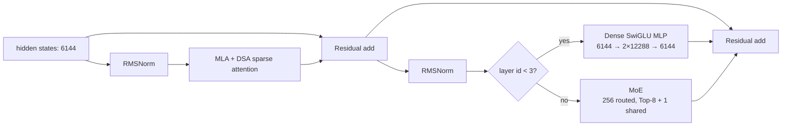
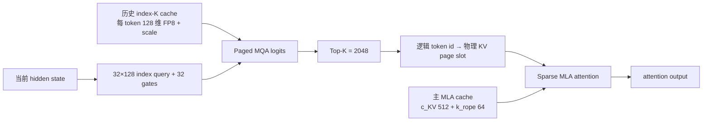
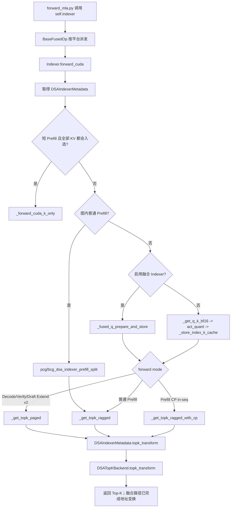

# SGLang 中 GLM-5.2 的模型结构、Attention 机制与算子实现

> 代码基线：SGLang commit `5cdf99af37c042e1ee886a2d61a7a02167f8c116`（2026-08-06）  
> 模型配置基线：`zai-org/GLM-5.2-FP8` 官方 `config.json`  
> 本文讨论的是 SGLang 当前代码如何加载、执行 GLM-5.2，而不是只复述模型论文或 Transformers 实现。

## 1. 先给结论：GLM-5.2 的代码到底在哪里

SGLang 仓库中**没有一个名为 `glm5_2.py` 的独立完整实现**。GLM-5.2 的 Hugging Face 架构名是 `GlmMoeDsaForCausalLM`，它采用“薄入口 + 复用 DeepSeek MLA/DSA 主干”的组织方式：

1. GLM-5.2 的模型入口类在 [`python/sglang/srt/models/glm4_moe.py`](../python/sglang/srt/models/glm4_moe.py#L1461)。
2. `GlmMoeDsaForCausalLM` 直接继承 `DeepseekV2ForCausalLM`，真正的 Transformer、MLA、DSA 和 MoE 主体在 [`python/sglang/srt/models/deepseek_v2.py`](../python/sglang/srt/models/deepseek_v2.py#L1719)。
3. DSA 的 indexer、分页打分、Top-K 和稀疏 attention 后端集中在 [`python/sglang/srt/layers/attention/dsa/`](../python/sglang/srt/layers/attention/dsa/) 与 [`dsa_backend.py`](../python/sglang/srt/layers/attention/dsa_backend.py)。
4. MLA absorb 路径及跨层共享 Top-K 的核心控制流在 [`forward_mla.py`](../python/sglang/srt/models/deepseek_common/attention_forward_methods/forward_mla.py#L183)。
5. GLM-5.2 的 MTP/NextN 入口也在 `glm4_moe.py`，主体复用 [`deepseek_nextn.py`](../python/sglang/srt/models/deepseek_nextn.py#L100)。

这并不意味着 SGLang 把 GLM-5.2 当作 DeepSeek 权重来加载。二者共享的是执行框架和算子组织；GLM-5.2 自己的 `config.json` 决定层数、维度、专家数量、索引头数量等，GLM 的入口类还负责处理专属的权重命名和 MTP 层号差异。

### 1.1 关键文件导航

| 功能 | 文件/目录 | 作用 |
|---|---|---|
| GLM-5.2 主模型入口 | [`glm4_moe.py`](../python/sglang/srt/models/glm4_moe.py#L1461) | `GlmMoeDsaForCausalLM` 继承主干，并指定共享专家融合架构名 |
| GLM-5.2 MTP 入口 | [`glm4_moe.py`](../python/sglang/srt/models/glm4_moe.py#L1466) | `GlmMoeDsaForCausalLMNextN`，处理第 78 层 MTP 权重映射及量化排除项 |
| 模型自动注册 | [`registry.py`](../python/sglang/srt/models/registry.py#L95) | 扫描模型模块中的 `EntryClass` 并按架构类名注册 |
| 架构识别与维度解析 | [`model_config.py`](../python/sglang/srt/configs/model_config.py#L106) | 将 GLM 架构识别为 DSA/MLA；读取 `index_topk`、head dim 等参数 |
| Transformer/Attention/MoE 主体 | [`deepseek_v2.py`](../python/sglang/srt/models/deepseek_v2.py#L1719) | `DeepseekV2AttentionMLA`、DecoderLayer、Model、CausalLM |
| MLA 前向 | [`forward_mla.py`](../python/sglang/srt/models/deepseek_common/attention_forward_methods/forward_mla.py#L339) | Q/KV 低秩投影、RoPE、DSA indexer、absorb BMM、Attention 调度 |
| DSA indexer | [`dsa_indexer.py`](../python/sglang/srt/layers/attention/dsa/dsa_indexer.py) | 构造索引 Q/K、量化索引 K、调用分页打分与 Top-K |
| DSA 稀疏后端 | [`dsa_backend.py`](../python/sglang/srt/layers/attention/dsa_backend.py) | prefill/decode 的稀疏 MLA 后端与 page-table 转换 |
| Top-K 后端 | [`dsa_topk_backend.py`](../python/sglang/srt/layers/attention/dsa/dsa_topk_backend.py) | `sgl-kernel`、PyTorch、FlashInfer Top-K 分派 |
| 分页 MQA 打分 | [`paged_mqa_logits_backend.py`](../python/sglang/srt/layers/attention/dsa/paged_mqa_logits_backend.py) | DeepGEMM、CuTe DSL、Aiter 打分后端 |
| DSA KV Cache | [`memory_pool.py`](../python/sglang/srt/mem_cache/memory_pool.py#L4276) | 主 MLA KV cache + 单独的 index K cache |
| MTP 主体 | [`deepseek_nextn.py`](../python/sglang/srt/models/deepseek_nextn.py#L100) | embedding/hidden 融合、NextN decoder、共享输出头 |
| MTP IndexShare 状态 | [`eagle_worker_v2.py`](../python/sglang/srt/speculative/eagle_worker_v2.py#L246) | 在多步草稿生成中保存、种入和复用 DSA Top-K |
| 后端自动选择 | [`overrides.py`](../python/sglang/srt/arg_groups/overrides.py#L1340) | 按 GPU 架构和 KV cache dtype 选择 DSA prefill/decode 后端 |
| 官方部署示例 | [`GLM-5.2.mdx`](../docs/cookbook/autoregressive/GLM/GLM-5.2.mdx) | BF16、FP8、NVFP4 启动方式与推荐参数 |
| E2E 测试 | [`test/registered/models_e2e/`](../test/registered/models_e2e/) | TP/DP、MTP、FP8、NVFP4、HiSparse、cache layer split 测试 |

## 2. GLM-5.2 是什么模型

GLM-5.2 是智谱/Z.ai 发布的超大规模稀疏 MoE 自回归语言模型，主要面向复杂推理、Agent、编码和长上下文任务。官方 checkpoint 使用 MIT License，支持约 100 万 token 的上下文窗口，并支持普通回答、交错思考、工具调用和 MTP 推测解码。

官方页面将 GLM-5.2 标为约 **753B 参数**。如果只按主干口径描述，也会看到“744B 级主模型、约 40B 激活参数”的说法；两者的差异主要来自参数统计口径以及 checkpoint 中附带的 NextN/MTP 层。工程上应以具体 checkpoint 的 `config.json` 和权重索引为准，不应仅凭模型名硬编码参数量。

### 2.1 官方配置中的主要尺寸

| 配置项 | GLM-5.2 值 | 含义 |
|---|---:|---|
| `architectures[0]` | `GlmMoeDsaForCausalLM` | SGLang 用它找到入口类 |
| `model_type` | `glm_moe_dsa` | Transformers 配置类型 |
| `vocab_size` | 154,880 | 词表大小 |
| `hidden_size` | 6,144 | Transformer 隐藏维度 |
| `num_hidden_layers` | 78 | 主模型 decoder 层数 |
| `max_position_embeddings` | 1,048,576 | 约 1M token 上下文 |
| `num_attention_heads` | 64 | MLA 查询头数 |
| `q_lora_rank` | 2,048 | Query 的低秩 latent 维度 |
| `kv_lora_rank` | 512 | 被缓存的 KV latent 维度 |
| `qk_nope_head_dim` | 192 | 每头不使用 RoPE 的内容维度 |
| `qk_rope_head_dim` | 64 | 每头使用 RoPE 的位置维度 |
| `v_head_dim` | 256 | 每头 value 输出维度 |
| `rope_theta` | 8,000,000 | RoPE base |
| `index_n_heads` | 32 | DSA 索引查询头数 |
| `index_head_dim` | 128 | 索引 Q/K 的 head dim |
| `index_topk` | 2,048 | 主 attention 每次选中的历史 token 上限 |
| `index_topk_freq` | 4 | 每 4 层计算一次索引 Top-K，其余层复用 |
| `first_k_dense_replace` | 3 | 前 3 层使用 dense MLP |
| `intermediate_size` | 12,288 | dense MLP 中间维度 |
| `n_routed_experts` | 256 | 每个 MoE 层的路由专家数 |
| `num_experts_per_tok` | 8 | 每个 token 激活 8 个路由专家 |
| `n_shared_experts` | 1 | 每层另有 1 个共享专家 |
| `moe_intermediate_size` | 2,048 | 单个路由专家的中间维度 |
| `num_nextn_predict_layers` | 1 | checkpoint 附带一层 MTP/NextN |

从第 4 个 Transformer 层开始，普通 FFN 被 MoE 替换。因此“总参数非常大”与“单 token 激活参数明显更小”可以同时成立：每个 token 只走 Top-8 路由专家，再加共享专家，而不是计算全部 256 个专家。

## 3. 单层结构

主模型由 token embedding、78 个 decoder layer、末尾 RMSNorm 和并行 LM head 组成。单层采用 pre-norm 和残差结构：



对应代码为：

- Attention：`DeepseekV2AttentionMLA`，见 [`deepseek_v2.py`](../python/sglang/srt/models/deepseek_v2.py#L1719)。
- Decoder layer：`DeepseekV2DecoderLayer`，见 [`deepseek_v2.py`](../python/sglang/srt/models/deepseek_v2.py#L2255)。
- 78 层模型：`DeepseekV2Model`，见 [`deepseek_v2.py`](../python/sglang/srt/models/deepseek_v2.py#L2566)。
- Causal LM 包装和权重加载：`DeepseekV2ForCausalLM`，见 [`deepseek_v2.py`](../python/sglang/srt/models/deepseek_v2.py#L2893)。

## 4. Attention 第一部分：MLA 如何压缩 KV Cache

GLM-5.2 的主 attention 不是普通 MHA/GQA，而是 MLA（Multi-head Latent Attention）。它的核心目标是：不要为每个 token 存储 64 份完整 K/V head，而是存储一个共享的低秩 KV latent，再在计算时通过权重吸收恢复等价的多头 attention。

### 4.1 Q、K、V 的形状

对每个 token 的隐藏状态 `h ∈ R^6144`：

1. 融合的 A 投影一次得到三部分：
   - Query latent：`q_latent ∈ R^2048`；
   - KV latent：`c_KV ∈ R^512`；
   - 单份 RoPE key：`k_rope ∈ R^64`。
2. `q_latent` 经 RMSNorm 和 `q_b_proj` 展开成 64 个 query head，每头 256 维：
   - `q_nope ∈ R^(64×192)`，表达内容；
   - `q_rope ∈ R^(64×64)`，表达位置。
3. `c_KV` 经 RMSNorm 后作为低秩 KV 表示；`kv_b_proj` 的权重在加载后被解释成内容 key 权重 `W_KC` 和 value 权重 `W_VC`。
4. RoPE 只施加在 64 维的 `q_rope`/`k_rope` 上，192 维内容部分不做旋转位置编码。

代码中对应的核心模块包括：

- `fused_qkv_a_proj_with_mqa`：融合 Q-A、KV-A 和 RoPE K 投影；
- `q_a_layernorm`、`kv_a_layernorm`：两个 latent 的 RMSNorm；
- `q_b_proj`：把 2,048 维 Query latent 展开为 64×256；
- `kv_b_proj`：提供 `W_KC` 与 `W_VC`；
- `o_proj`：把 64×256 的多头输出映射回 6,144。

这些定义都在 [`DeepseekV2AttentionMLA.__init__`](../python/sglang/srt/models/deepseek_v2.py#L1719) 中。

### 4.2 Absorb 模式为什么不需要显式展开全部 K/V

在 decode 常用的 absorb 路径中，矩阵乘法结合律被用来减少缓存尺寸：

```text
q_content = q_nope @ W_KC                  # 每头 192 -> 512
score(j)  = q_content · c_KV[j]
          + q_rope · k_rope[j]             # 仅在 DSA 选中的历史位置 j 上计算

latent_out = softmax(score) @ c_KV          # 每头得到 512 维 latent 输出
head_out   = latent_out @ W_VC              # 每头 512 -> 256
output     = o_proj(concat(head_out_0...63)) # 16384 -> 6144
```

`W_KC` 被吸收到 query 侧，`W_VC` 被吸收到 attention 输出侧，所以 KV cache 无需显式保存每个 head 的 192 维 K 和 256 维 V。每层每个 token 的主 MLA cache 逻辑上只需保存：

```text
[c_KV: 512, k_rope: 64] = 576 个值
```

这比保存 64 头完整 K/V 小得多。实际显存字节数还取决于 `--kv-cache-dtype`、对齐、page size 和 scale 元数据，不能简单用 `576 × dtype_size` 作为完整分配量。

实现入口是 [`forward_absorb_prepare`](../python/sglang/srt/models/deepseek_common/attention_forward_methods/forward_mla.py#L339) 和 [`forward_absorb_core`](../python/sglang/srt/models/deepseek_common/attention_forward_methods/forward_mla.py#L836)。其中会根据 dtype、GPU 和所选后端在普通 BMM、FP8 BMM、DeepGEMM BMM 以及融合 BMM+attention 路径间选择。

## 5. Attention 第二部分：DSA 如何从 1M 历史中选 2048 个 token

MLA 解决 KV cache 宽度问题，DSA（DeepSeek Sparse Attention 风格的细粒度稀疏 attention）解决长度方向的问题。它采用两阶段结构：

1. **轻量 indexer** 扫描可见历史 token，为每个位置产生相关性分数；
2. 选出分数最高的 `Top-K=2048` 个 token，主 MLA 只在这些 token 上执行 attention。



### 5.1 Indexer 的 Q、K 与 gate

Indexer 的主要数据流在 [`dsa_indexer.py`](../python/sglang/srt/layers/attention/dsa/dsa_indexer.py)：

- `Wq_b`：把 2,048 维 Query latent 映射为 32 个、每个 128 维的 index query；
- index key 投影：把 6,144 维 hidden state 映射为每 token 一份 128 维 index key；
- head gate 投影：同时生成 32 个 query-head gate，用来组合各索引头的相似度；
- index Q/K 的前 64 维带 RoPE，从而让轻量索引同时感知内容和位置；
- index Q/K 会量化成 FP8；历史 index K 写进独立于主 MLA cache 的 DSA index cache。

概念上的索引分数可以写成：

```text
index_score(token j) = Σ_h gate_h × dot(index_q_h, index_k_j)
```

代码还会结合缩放、量化 scale、因果边界以及可能的强制本地窗口，之后再调用 Top-K。公式用于理解数据流，不代表内核逐条执行完全相同的 PyTorch 运算。

当当前可见序列长度不超过 2,048 时，不需要真正筛选：所有有效历史位置都可以直接进入主 attention。当长度超过 2,048 时，Top-K 才带来显著稀疏化。

### 5.2 稀疏并不等于整层完全 O(1)

在长序列上：

- indexer 仍需用很窄的 128 维 index K 扫描历史，因此生产索引的层仍有与上下文长度相关的工作；
- 昂贵的主 MLA 只对 2,048 个位置计算，主 attention 的工作量不再随完整上下文线性增长；
- index K cache 很窄且使用 FP8，扫描成本远小于对所有历史位置做完整 64 头 MLA。

因此更准确的说法是“把高成本的主 attention 限制为固定 2048 个候选”，而不是笼统地说“所有 attention 成本都与长度无关”。

## 6. IndexShare：为什么不是每一层都重新 Top-K

GLM-5.2 的配置为 `index_topk_freq=4`、`index_skip_topk_offset=3`，并带有显式的 indexer 类型模式。直观上是：**每 4 个 Transformer 层共享一组 Top-K 位置**。

- 第 0、1、2 层为 full attention/特殊起始层；
- 从第 3 层开始形成共享组；
- 生产层计算 index logits 和 Top-K；
- 紧随其后的 3 层复用这份 Top-K，不再各自做一次全历史 indexer 打分和排序。

SGLang 中的控制链路如下：

1. [`dsa_layer_skips_topk`](../python/sglang/srt/configs/model_config.py#L195) 根据 pattern 或 freq/offset 判断当前层是否复用 Top-K。
2. `DeepseekV2AttentionMLA.__init__` 设置 `skip_topk` 和 `next_skip_topk`。
3. [`should_run_indexer`](../python/sglang/srt/models/deepseek_common/attention_forward_methods/forward_mla.py#L183) 保证共享层不会误用未初始化的 indexer 权重。
4. `forward_absorb_prepare` 要么运行本层 indexer，要么接收 `prev_topk_indices`。
5. `forward_absorb_core` 在下一层需要共享时返回本层 Top-K。
6. `DeepseekV2Model.forward` 在 decoder 层之间传递 `topk_indices`；pipeline parallel 跨 stage 时也会在必要位置继续传递。

需要特别区分：IndexShare 共享的是**选中的 token 位置**，不是共享 Transformer attention 权重，也不是让四层共用同一份主 MLA KV cache。四层仍分别执行自己的主稀疏 MLA，仍拥有各层自己的主 KV cache。

官方说明中，这种设计让四层中的后三层跳过 indexer dot-product 和 Top-K；在 1M 上下文的模型分析口径下，单 token attention FLOPs 可获得约 2.9 倍降低。该数字是模型设计分析结果，不应直接等同于任意硬件、任意 batch 下的端到端吞吐提升。

## 7. DSA 的 KV Cache 具体存什么

SGLang 为 DSA 使用 [`DSATokenToKVPool`](../python/sglang/srt/mem_cache/memory_pool.py#L4276)，它在 `MLATokenToKVPool` 基础上增加 index K cache。逻辑上每层有两类缓存：

| 缓存 | 内容 | 用途 |
|---|---|---|
| 主 MLA KV cache | `c_KV[512] + k_rope[64]` | 被 Top-K 选中后执行真正的稀疏 MLA |
| DSA index K cache | `index_k[128]` 的 FP8 数据与 scale | 轻量扫描整个可见历史并产生候选分数 |

相关底层操作包括：

- `set_mla_kv_buffer_triton`：将 MLA latent/rope K 写入分页缓存；
- `quantize_k_cache_separate`：单独量化 index K；
- fused indexer K norm/RoPE/quant/store：将归一化、RoPE、FP8 量化和 cache 写入融合；
- `transform_index_page_table_decode/prefill`：把选中的逻辑 token 位置转换成物理 KV slot/page 索引。

这里的 `block_size=128` 是 index 向量量化/内核布局相关的分组维度，不应误解为“每 128 个 token 才共用一个 scale”。

## 8. Prefill 与 Decode 的完整 Attention 调用链

### 8.1 Prefill

```text
hidden_states
  → fused Q/KV-A projection
  → q/kv latent RMSNorm
  → q_b projection + split(q_nope, q_rope)
  → RoPE
  → 写主 MLA KV cache
  → 生产层写 index K cache、计算 paged logits、Top-K
     或共享层复用 prev_topk_indices
  → 将 Top-K 逻辑位置转换为物理 page/slot
  → sparse MLA prefill kernel
  → latent output @ W_VC
  → o_proj
```

在 prefill 中还可能启用 context parallel、分块 prefill、ragged Top-K、Q8KV8 融合路径，所以实际内核组合会随启动参数变化。

### 8.2 Decode

```text
单步 hidden_state
  → Q/KV latent 投影、RMSNorm、RoPE
  → 当前 token 的主 MLA KV 和 index K 写入 paged cache
  → indexer 对历史 index K cache 做 paged MQA logits
  → Top-K 2048
  → page-table transform
  → sparse MLA decode kernel 只读取选中的主 KV slots
  → W_VC BMM + o_proj
```

Decode 的 query 数通常很小，因而使用面向单 token/小 query 的 FA3、FlashMLA-KV、TRT-LLM 或 TileLang 等路径；prefill 的 query 数更大，通常使用 `flashmla_sparse` 或其他批量稀疏 kernel。

## 9. GLM-5.2 Attention 到底用到了哪些算子

不能用一个固定算子名概括 GLM-5.2。SGLang 先构造相同的逻辑数据流，再按 GPU 架构、dtype、prefill/decode 阶段和显式 CLI 参数选择不同后端。

### 9.1 投影、归一化、RoPE 与 absorb BMM

| 类别 | 主要算子/实现 | 作用 |
|---|---|---|
| 并行线性层 | `ReplicatedLinear`、`ColumnParallelLinear`、`RowParallelLinear` | Q/KV-A、Q-B、KV-B、O 投影及 TP 切分 |
| 归一化 | `RMSNorm`、融合 RMS+FP8/MXFP4 quant | 对 q latent、kv latent 和 decoder hidden 做归一化 |
| RoPE | `get_rope_wrapper` 及融合 indexer RoPE kernel | 对主 attention 和 indexer 的位置维度旋转 |
| 普通吸收 BMM | `torch.bmm` | `q_nope @ W_KC`、latent output `@ W_VC` |
| FP8 BMM | `bmm_fp8` | FP8 权重/激活路径的 absorb 矩阵乘 |
| DeepGEMM BMM | grouped/FP8 BMM | NVIDIA 上的高性能矩阵乘路径 |
| 融合 Q 构造 | `absorbed_bmm_concat_cast_q_fp8` | 融合 W_KC BMM、拼接 RoPE Q 和 FP8 cast |
| BMM+attention 融合 | `mla_bmm_then_unified_attention`、`bcg_mla_bmm_then_unified_attention` | 减少中间张量和 kernel launch |

相关代码位于 [`forward_mla.py`](../python/sglang/srt/models/deepseek_common/attention_forward_methods/forward_mla.py) 和 [`cache_ops.py`](../python/sglang/kernels/ops/kvcache/cache_ops.py)。当前代码还专门处理 GLM-5 的 `qk_nope_head_dim=192`：融合 FP8 Q kernel 对非 2 的幂维度采用 split-K 路径，而不是假定 DeepSeek 的 128 维。

### 9.2 DSA indexer 算子

| 阶段 | 算子/后端 | 说明 |
|---|---|---|
| Index Q | `fused_q_indexer_rope_first_quant` | Q 投影后融合 RoPE 前半部分和 FP8 量化 |
| Index K | `fused_k_indexer_norm_rope` / `_store` | 融合 K 归一化、RoPE、量化，`_store` 版本直接写 cache |
| 通用量化 | Triton/TileLang `act_quant` | 将 index Q/K 量化为 FP8 及 scale |
| ROCm index K | Aiter `indexer_k_quant_and_cache` | AMD 路径的融合量化与 cache 写入 |
| 分页全历史打分 | DeepGEMM `fp8_paged_mqa_logits` | NVIDIA 默认/自动候选之一 |
| 分页全历史打分 | CuTe DSL paged MQA logits | 可选 CUDA 实现 |
| 分页全历史打分 | Aiter paged MQA logits | ROCm 实现 |
| Top-K | `sgl_kernel.fast_topk_v2` | 默认高性能 Top-K 后端 |
| Top-K+索引变换 | `fast_topk_transform_fused`、ragged fused 版本 | 融合选择和物理索引变换 |
| 备用 Top-K | `torch.topk` | 通用、便于兼容/调试 |
| 备用 Top-K | FlashInfer Top-K/transform | 可选后端 |

Top-K 分派入口是 [`dsa_topk_backend.py`](../python/sglang/srt/layers/attention/dsa/dsa_topk_backend.py)，分页打分分派入口是 [`paged_mqa_logits_backend.py`](../python/sglang/srt/layers/attention/dsa/paged_mqa_logits_backend.py)。

### 9.3 主稀疏 MLA 算子

| CLI/内部后端 | 代表算子 | 典型用途 |
|---|---|---|
| `flashmla_sparse` | `sgl_kernel.flash_mla.flash_mla_sparse_fwd` | CUDA BF16 prefill 的常用默认路径 |
| `flashmla_sparse_q8` | Q8KV8 sparse FlashMLA | Hopper 原生 FP8 prefill 可选路径 |
| `flashmla_kv` | `flash_mla_with_kvcache` | Hopper FP8 KV cache 路径 |
| `fa3` | `flash_attn_with_kvcache` | Hopper BF16 decode 默认路径 |
| `trtllm` | TRT-LLM batch decode with MLA KV cache | Blackwell decode/FP8 默认路径 |
| `flashinfer_sparse_mla` | FlashInfer sparse MLA forward | SM120/SM121 GLM FP8 特殊默认路径 |
| `tilelang` | `tilelang_sparse_fwd` | ROCm 默认 prefill/decode 路径，也可用于其他支持环境 |
| Triton | `triton_sparse_mla_fwd` | Triton 稀疏 MLA 实现 |
| `aiter` | `mla_decode_fwd` / `mla_prefill_fwd` | ROCm Aiter 路径 |

当前 [`_dsa_split_backend_resolution`](../python/sglang/srt/arg_groups/overrides.py#L1340) 的自动选择逻辑可以概括为：

| 硬件/缓存类型 | Prefill 默认 | Decode 默认 |
|---|---|---|
| CUDA，BF16 KV，Hopper | `flashmla_sparse` | `fa3` |
| CUDA，BF16 KV，Blackwell | `flashmla_sparse` | `trtllm` |
| CUDA，FP8 KV，Hopper | `flashmla_kv` | `flashmla_kv` |
| CUDA，FP8 KV，Blackwell | `trtllm` | `trtllm` |
| SM120/SM121 + GLM + FP8 KV | `flashinfer_sparse_mla` | `flashinfer_sparse_mla` |
| ROCm（未手动指定） | `tilelang` | `tilelang` |
| 启用 HiSparse | 由 HiSparse 钩子按 dtype 选择 | 同左 |

这是当前 commit 的默认值，不是永恒不变的兼容性承诺。用户显式传入 `--dsa-prefill-backend` 或 `--dsa-decode-backend` 时会覆盖自动结果；后端还必须满足具体 GPU、SGL Kernel/FlashInfer/Aiter 版本与 KV dtype 的约束。

## 10. MoE 部分使用哪些算子

GLM-5.2 的计算量不只在 attention。后 75 层的 MoE 也是主要算子来源。

### 10.1 Router

Router 对每个 token 计算 256 个专家分数，配置采用：

- `scoring_func = sigmoid`；
- `topk_method = noaux_tc`；
- `num_experts_per_tok = 8`；
- `norm_topk_prob = true`；
- `routed_scaling_factor = 2.5`；
- router 计算使用 FP32 精度语义以保证选择稳定性。

主要实现可从 [`topk.py`](../python/sglang/srt/layers/moe/topk.py) 查看。不同路径可能调用 `dsv3_router_gemm`、BF16 输入/FP32 输出的线性层、Aiter router GEMM，以及分组 Top-K、校正 bias、重归一化等融合算子。

### 10.2 专家计算

每个被选专家执行 SwiGLU 风格的两段 GEMM：

```text
gate_up = GEMM_W13(x)             # 6144 -> 2 × 2048
middle  = SiLU(gate) * up
out     = GEMM_W2(middle)         # 2048 -> 6144
```

SGLang 通过统一 fused-MoE 接口选择 DeepGEMM、CUTLASS、FlashInfer、Triton 或 Aiter 等实现，并可按 checkpoint 使用 BF16、FP8、NVFP4/MXFP4 等权重量化路径。入口包括 [`ep_moe/layer.py`](../python/sglang/srt/layers/moe/ep_moe/layer.py) 与 [`fused_moe_triton/`](../python/sglang/srt/layers/moe/fused_moe_triton/)。

在 Expert Parallel 场景下，还会使用 token dispatch/combine 通信算子。SGLang 提供标准 all-to-all、DeepEP、Mooncake、Mori、NIXL 等 dispatcher；它们位于 [`token_dispatcher/`](../python/sglang/srt/layers/moe/token_dispatcher/)。这类算子属于部署并行策略，不是 GLM-5.2 数学结构中固定的一部分。

## 11. MTP、IndexShare 与 KVShare

GLM-5.2 checkpoint 带有一层 NextN/MTP，用于推测解码：草稿模型基于主模型 hidden state 和 token embedding 预测后续 token，再由主模型批量验证。

SGLang 中：

1. [`DeepseekModelNextN`](../python/sglang/srt/models/deepseek_nextn.py#L100) 对 token embedding 和前一目标层 hidden state 分别归一化；
2. `fused_eh_norm` 可融合这两个归一化步骤；
3. 两者拼接后经 `eh_proj` 投影；
4. 再进入一层 `DeepseekV2DecoderLayer(is_nextn=True)`，因此继续复用 DSA/MLA 与 MoE 算子；
5. 输出通过共享的末尾 norm 与 LM head 产生草稿 logits。

GLM-5.2 与 DeepSeek 默认 MTP 层号不同。`GlmMoeDsaForCausalLMNextN` 在 [`glm4_moe.py`](../python/sglang/srt/models/glm4_moe.py#L1466) 中将 GLM 的第 78 层权重正确映射为独立草稿模型，并维护相应量化排除规则。

### 11.1 MTP IndexShare

官方配置的 `index_share_for_mtp_iteration=true` 表示多次草稿迭代不必反复扫描完整 index K cache。SGLang 的 [`EAGLEWorkerV2`](../python/sglang/srt/speculative/eagle_worker_v2.py#L246) 保存首轮产生的 Top-K，并在后续草稿步中种入/复用该状态。当前代码对这一优化有适用条件，例如只在相应的 MTP Top-K 设置满足约束时启用，不能假设所有 speculative 配置都会进入该路径。

### 11.2 KVShare

官方设计中的 KVShare 是为避免后续草稿步使用由草稿模型自己生成、可能存在分布偏差的 KV：后续草稿迭代复用第一步对应的目标模型 KV/候选集合，使训练和推理时看到的条件更一致，并改善接受率。

它与“不同 Transformer 层共用一块 KV cache”不是一回事，也与跨请求的 prefix cache 复用无关。这里讨论的是一次 speculative decode 内部，目标模型与多个草稿迭代之间怎样复用条件信息。

## 12. BF16、FP8 与 NVFP4 对算子的影响

SGLang cookbook 给出三类常见 checkpoint：

- **BF16**：精度基准清晰，但约 700B 级权重对显存和节点数要求极高；
- **FP8**：官方常用部署格式，配置采用动态 E4M3 与 `[128, 128]` block；矩阵乘和 KV cache 可以分别决定是否 FP8；
- **NVFP4**：主要压缩 MoE 专家权重，共享专家等部分可能保持较高精度，通常面向 Blackwell。

需要区分三件事：

1. **权重 dtype**：决定线性层和 MoE GEMM 走 BF16、FP8 还是 FP4 kernel；
2. **KV cache dtype**：由 `--kv-cache-dtype` 控制，直接影响 DSA attention 后端选择；
3. **Indexer Q/K dtype**：DSA 内部会把轻量索引向量量化为 FP8，它不等于主模型全部权重都是 FP8。

因此“加载 FP8 checkpoint”并不能单独推出“attention 一定使用某个 FP8 kernel”，必须同时看 GPU 架构、KV cache dtype 和 backend 参数。

## 13. 如何沿代码实际追一遍

建议按下面顺序阅读：

1. 从 [`glm4_moe.py#GlmMoeDsaForCausalLM`](../python/sglang/srt/models/glm4_moe.py#L1461) 确认入口及继承关系；
2. 到 [`model_config.py#is_deepseek_dsa`](../python/sglang/srt/configs/model_config.py#L106) 看架构如何被识别为 DSA；
3. 阅读 [`DeepseekV2AttentionMLA.__init__`](../python/sglang/srt/models/deepseek_v2.py#L1719)，记录所有维度和投影；
4. 阅读 [`forward_absorb_prepare`](../python/sglang/srt/models/deepseek_common/attention_forward_methods/forward_mla.py#L339)，看 Q/KV latent、RoPE 和 indexer 如何准备；
5. 进入 [`dsa_indexer.py`](../python/sglang/srt/layers/attention/dsa/dsa_indexer.py)，追 index Q/K、paged logits 和 Top-K；
6. 回到 [`forward_absorb_core`](../python/sglang/srt/models/deepseek_common/attention_forward_methods/forward_mla.py#L836)，看 Top-K 如何交给主稀疏 MLA；
7. 进入 [`dsa_backend.py`](../python/sglang/srt/layers/attention/dsa_backend.py) 查看具体 GPU kernel；
8. 到 [`memory_pool.py#DSATokenToKVPool`](../python/sglang/srt/mem_cache/memory_pool.py#L4276) 看两类 cache 的分配和写入；
9. 最后阅读 [`deepseek_nextn.py`](../python/sglang/srt/models/deepseek_nextn.py#L100) 与 [`eagle_worker_v2.py`](../python/sglang/srt/speculative/eagle_worker_v2.py#L246) 理解 MTP 共享。

可用于回归验证的 GLM-5.2 测试包括：

- [`test_dsa_glm52_tp_mtp.py`](../test/registered/models_e2e/test_dsa_glm52_tp_mtp.py)：TP + MTP；
- [`test_dsa_glm52_dp_mtp.py`](../test/registered/models_e2e/test_dsa_glm52_dp_mtp.py)：DP + MTP；
- [`test_dsa_glm52_nvfp4_tp_mtp.py`](../test/registered/models_e2e/test_dsa_glm52_nvfp4_tp_mtp.py)：NVFP4 + TP + MTP；
- [`test_dsa_glm52_hisparse.py`](../test/registered/models_e2e/test_dsa_glm52_hisparse.py)：HiSparse；
- [`test_dsa_glm52_cache_layer_split.py`](../test/registered/models_e2e/test_dsa_glm52_cache_layer_split.py)：cache layer split；
- [`test_glm52_cp_index_share.py`](../test/registered/cp/test_glm52_cp_index_share.py)：context parallel + IndexShare。

## 14. 容易混淆的几个结论

1. **GLM-5.2 没有独立的 `glm5_2.py` 并不代表没有适配。** 入口、配置识别、权重映射、MTP 层号、融合 kernel 的 192 维支持和 E2E 测试都是显式适配。
2. **MLA 与 DSA 解决不同问题。** MLA 压缩每个 token 的 KV 表示宽度；DSA 从长度方向筛选 2,048 个历史 token。
3. **IndexShare 共享的是 Top-K 索引。** 它不共享层权重，也不让四层直接复用同一层的主 KV cache。
4. **DSA 不是纯局部窗口。** Top-K 可以从整个可见历史中选择，因此能保留远距离依赖；因果约束仍然有效。
5. **短上下文时稀疏收益有限。** 当可见历史不超过 2,048，候选已经覆盖全部历史。
6. **“GLM-5.2 使用哪个 attention 算子”没有唯一答案。** 至少要同时给出 GPU、prefill/decode、权重/KV dtype 和 CLI backend 才能确定。
7. **MTP KVShare 不是跨请求 KV cache 池化。** 它是一次推测解码过程内的条件复用优化。

## 15. 参考资料

- [GLM-5.2 FP8 官方 config.json](https://huggingface.co/zai-org/GLM-5.2-FP8/raw/main/config.json)
- [GLM-5.2 官方模型卡](https://huggingface.co/zai-org/GLM-5.2)
- [Z.ai：GLM-5.2 官方介绍](https://z.ai/blog/glm-5.2)
- [Hugging Face / Z.ai：GLM-5.2 技术文章](https://huggingface.co/blog/zai-org/glm-52-blog)
- [SGLang GLM-5.2 部署文档](../docs/cookbook/autoregressive/GLM/GLM-5.2.mdx)

---

### 一句话总结

SGLang 中的 GLM-5.2 是一个 **78 层、6144 hidden、256 专家 Top-8、约 1M context 的超大 MoE 模型**；它以 **MLA 低秩 KV cache** 降低缓存宽度，以 **DSA indexer + Top-2048 稀疏 attention** 降低长上下文主 attention 的长度成本，再通过 **每四层 IndexShare** 和 **MTP 内的 Index/KV 共享**减少重复计算。其高性能实现不是单一算子，而是一组按硬件与 dtype 动态选择的投影、量化、分页打分、Top-K、稀疏 MLA、MoE GEMM 和通信算子。

## 16. `layers/attention/dsa` 目录的实际调用顺序

本节专门说明 [`python/sglang/srt/layers/attention/dsa/`](../python/sglang/srt/layers/attention/dsa/) 中 8 个文件在 GLM-5.2 推理时如何被调用。需要先强调：这 8 个文件不是按照文件名从上到下依次执行，而是由目录外的模型 forward 和 attention backend 先构造元数据，再进入 `Indexer`，随后根据硬件、forward mode、CUDA Graph 和 CP 状态分叉。

### 16.1 总体入口：模型先决定“本层计算还是复用 Top-K”

GLM-5.2 的 attention 实现复用 `DeepseekV2AttentionMLA`。模型层先在 [`forward_mla.py#DeepseekMLAForwardMixin.should_run_indexer`](../python/sglang/srt/models/deepseek_common/attention_forward_methods/forward_mla.py#L127) 判断当前层是否应运行自己的 Indexer：

- `skip_topk=false` 的 Indexer 层会真正执行 DSA 索引计算；
- `skip_topk=true` 的共享层直接沿用上一 IndexShare 组传下来的 `prev_topk_indices`；
- NextN/MTP 层在没有可复用索引时允许使用自己的 Indexer；
- 如果本层复用了 `prev_topk_indices`，那么本次 forward **不会进入 `dsa_indexer.py` 的 Q/K/logits/Top-K 主流程**。

真正调用发生在 [`forward_mla.py`](../python/sglang/srt/models/deepseek_common/attention_forward_methods/forward_mla.py#L357) 和同文件的另一条普通分支 [`forward_mla.py`](../python/sglang/srt/models/deepseek_common/attention_forward_methods/forward_mla.py#L432)：

```python
topk_indices = self.indexer(
    x=hidden_states,
    q_lora=q_lora,
    positions=positions,
    forward_batch=forward_batch,
    layer_id=self.layer_id,
)
```

这里的 `self.indexer(...)` 并不会固定调用某一个 `forward`。`Indexer` 继承 `BaseFusedOp`，所以 [`BaseFusedOp.forward`](../python/sglang/kernels/fused_op.py#L624) 会按当前设备派发：

```text
CUDA                   -> Indexer.forward_cuda(...)
ROCm/HIP               -> Indexer.forward_hip 不存在，回退 Indexer.forward_cuda(...)
Ascend NPU             -> DSANPUIndexerMixin.forward_npu(...)
Intel XPU              -> Indexer.forward_xpu(...) -> Indexer.forward_cuda(...)
纯 Torch/native        -> Indexer.forward_native(...)，直接报 NotImplementedError
```

因此，目录内最核心的运行时入口是 [`dsa_indexer.py#Indexer.forward_cuda`](../python/sglang/srt/layers/attention/dsa/dsa_indexer.py#L1778) 和 [`dsa_npu_indexer.py#DSANPUIndexerMixin.forward_npu`](../python/sglang/srt/layers/attention/dsa/dsa_npu_indexer.py#L34)。

### 16.2 在进入 Indexer 之前：`dsa_backend.py` 先准备元数据

在模型调用 Indexer 之前，attention backend 已通过 [`dsa_backend.py#init_forward_metadata`](../python/sglang/srt/layers/attention/dsa_backend.py#L778) 构造本次 forward 的 `DSAMetadata`。这一阶段会调用 [`dsa/utils.py`](../python/sglang/srt/layers/attention/dsa/utils.py) 中的工具函数，主要顺序是：

```text
ForwardBatch
  -> dsa_backend.init_forward_metadata(...)
     -> 判定 Decode / Target Verify / Draft Extend / 普通 Extend
     -> utils.can_dsa_prefill_cp_round_robin_split(...)
     -> 必要时调用 utils.dsa_cp_round_robin_split_data(...)
     -> 必要时调用 utils.dsa_cp_round_robin_split_q_seqs(...)
     -> utils.compute_dsa_seqlens(...)
     -> utils.pad_dsa_cache_seqlens(...)
     -> 生成 page_table_1、real_page_table、cu_seqlens、ks/ke 等字段
```

`dsa_backend.py` 随后通过 [`get_indexer_metadata`](../python/sglang/srt/layers/attention/dsa_backend.py#L3383) 创建 [`DSAIndexerMetadata`](../python/sglang/srt/layers/attention/dsa/dsa_indexer_metadata.py#L102)。该对象是一个轻量适配层，不重新计算 Q/K，而是向 Indexer 提供：

- `cache_seqlens_int32`：请求级 KV 长度；
- `seqlens_expanded`：按 query token 展开的可见 KV 长度；
- `page_table_1`：page size 为 1 的逐 token 物理槽位表；
- `real_page_table`：按真实 KV page size 压缩的页表；
- `indexer_k_start_end`：Prefill ragged logits 每行合法区间的 `ks/ke`；
- `topk_indices_offset`：ragged Top-K 局部索引到全局 KV 偏移的转换量；
- Top-K backend、PAGED/RAGGED 变换方式以及分页 MQA 调度元数据。

也就是说，正确的前置调用顺序是：

```text
dsa_backend.init_forward_metadata(...)
  -> dsa/utils.py 中的长度与 CP 工具
  -> 产生 DSAMetadata
  -> dsa_backend.get_indexer_metadata(...)
  -> DSAIndexerMetadata
  -> Indexer.forward_cuda/forward_npu(...)
```

### 16.3 CUDA/HIP 主调用链

[`Indexer.forward_cuda`](../python/sglang/srt/layers/attention/dsa/dsa_indexer.py#L1778) 是 CUDA/HIP 的总调度器，其内部调用顺序可概括为：



下面分阶段说明。

#### 阶段 A：Q、K、head gate 与 index-K cache

非融合路径从 [`_get_q_k_bf16`](../python/sglang/srt/layers/attention/dsa/dsa_indexer.py#L491) 开始：

```text
q_lora
  -> wq_b
  -> reshape 为 [tokens, index_heads, head_dim]
  -> 对 q_rope 子空间施加 RoPE
  -> 非融合路径执行 Hadamard rotate
  -> BF16 query

hidden_states
  -> wk
  -> k_norm
  -> 对 k_rope 子空间施加 RoPE
  -> 非融合路径执行同一个 Hadamard rotate
  -> BF16 index-key

hidden_states
  -> weights_proj
  -> 1/sqrt(index_heads)
  -> 乘 q_scale 与 1/sqrt(head_dim)
  -> logits head gate
```

随后：

```text
BF16 query
  -> act_quant(...)
  -> q_fp8 + q_scale

BF16 index-key
  -> _store_index_k_cache(...)
  -> fused_store / AITER store / act_quant + pool.set_index_k_scale_buffer
  -> 写入 DSATokenToKVPool 的独立 index-K-with-scale buffer
```

融合路径由 [`_fused_q_prepare_and_store`](../python/sglang/srt/layers/attention/dsa/dsa_indexer.py#L708) 执行：

```text
hidden_states
  -> wk_weights_proj 一次 GEMM
  -> split 为 key_raw 与 weights_raw
  -> _fused_k_prepare_and_store(...)
     -> K norm + RoPE + FP8 quant + cache scatter store

q_lora
  -> wq_b
  -> fused_q_indexer_rope_first_quant(...)
  -> q_fp8 + 已合并缩放的 head gate
```

重要区别是：融合路径为了匹配 fused K kernel，不再执行旧路径的 Hadamard rotation；Decode 读取到的 index-K cache 布局必须与写入路径保持一致。

#### 阶段 B：短 Prefill 的 K-only 快路径

[`_should_skip_logits_computation`](../python/sglang/srt/layers/attention/dsa/dsa_indexer.py) 会检查普通 Prefill 的最大 KV 长度是否不超过 `index_topk`。例如 GLM-5.2 的 `index_topk=2048`，若当前所有请求长度都不超过 2048，则所有可见 token 必然被选中，没有必要真的计算 QK logits。

调用顺序变为：

```text
Indexer.forward_cuda
  -> _forward_cuda_k_only(...)
     -> 融合模式：_fused_k_weights -> _fused_k_prepare_and_store
     -> 非融合模式：_get_k_bf16 -> _store_index_k_cache
     -> 若需要 indices：构造 dummy_logits
     -> metadata.topk_transform 生成连续有效索引
```

它仍然必须写 index-K cache，因为后续 Decode 会读取这些 K；跳过的只是当前 Prefill 的 Q、head gate 和真实 logits 计算。

### 16.4 Decode、Target Verify 与 Draft Extend v2：分页调用链

这三种模式最终进入 [`_get_topk_paged`](../python/sglang/srt/layers/attention/dsa/dsa_indexer.py#L899)：

```text
Indexer.forward_cuda
  -> _get_topk_paged(...)
     -> metadata.get_page_table_64() 或 get_page_table_1()
     -> _get_index_k_read_buffer(...)
     -> 取得物理 index-K-with-scale cache
     -> 选择 paged MQA logits 算子
     -> 得到 FP32 logits
     -> _mask_init_and_local_tokens(...)
     -> DSAIndexerMetadata.topk_transform(...)
     -> DSATopKBackend.topk_transform(...)
  -> 融合 Top-K 时得到物理 KV token slot；非融合时先得到局部逻辑索引
```

分页 MQA 后端在 [`Indexer.__init__`](../python/sglang/srt/layers/attention/dsa/dsa_indexer.py#L252) 中通过 [`DSAPagedMQALogitsBackend.resolve`](../python/sglang/srt/layers/attention/dsa/paged_mqa_logits_backend.py#L35) 提前解析：

- ROCm/HIP：使用 AITER；支持 preshuffle 时读取真实分页表，否则使用 page-size=1 legacy 表；
- CUDA 默认：使用 DeepGEMM；
- Blackwell SM100 且显式配置 CuteDSL：可调用 CuteDSL paged MQA；
- Target Verify 在满足二维上下文长度布局时，可进入 DeepGEMM native 多 query 路径；否则走 split 路径。

所以 `paged_mqa_logits_backend.py` 的调用位置很早：它主要在 `Indexer` 初始化时决定后端；真正的后端算子调用发生在 `_get_topk_paged` 中。

### 16.5 普通 Prefill：ragged 调用链

普通 Prefill 最终进入 [`_get_topk_ragged`](../python/sglang/srt/layers/attention/dsa/dsa_indexer.py#L1166)。它与 Decode 最大的不同是：Decode 直接让 paged kernel 按页表读取缓存，而 Prefill ragged 路径先把本 batch 所需的 index-K gather 成连续缓存。

```text
Indexer.forward_cuda
  -> _get_topk_ragged(...)
     -> metadata.get_page_table_64()/get_page_table_1()
     -> metadata.get_indexer_kvcache_range() 得到 ks/ke
     -> DSATokenToKVPool.get_index_k_scale_buffer(...)
        -> 按页表 gather 连续 k_fp8 与 k_scale
     -> _should_chunk_mqa_logits(...)
        -> 小矩阵：一次 fp8_mqa_logits
        -> 大矩阵：按 query 行分块 fp8_mqa_logits
     -> _mask_init_and_local_tokens(...)
     -> metadata.topk_transform(...)
     -> Top-K 结果写入最终 [tokens, index_topk] Tensor
```

分块只切 query 行，不切 K 宽度。每一块仍然使用全局 `ks/ke`、`topk_indices_offset` 或 token-to-batch 映射，因此分块不会改变最终索引地址域。这样做的原因是 Prefill 的完整 FP32 logits 形状近似为 `[query_tokens, total_kv_tokens]`，长上下文下可能占用很大显存。

### 16.6 Top-K 选择和地址变换的最后两层

无论 paged 还是 ragged，都会先进入 [`DSAIndexerMetadata.topk_transform`](../python/sglang/srt/layers/attention/dsa/dsa_indexer_metadata.py#L150)。它负责选择本次应使用的：

- 有效长度 `lengths`；
- query 累积长度 `cu_seqlens_q_topk`；
- token 级 Top-K 偏移 `topk_indices_offset`；
- packed logits 行起点 `row_starts/ks`；
- CP 或分块后的 `batch_idx_list`。

然后它调用 [`DSATopKBackend.topk_transform`](../python/sglang/srt/layers/attention/dsa/dsa_topk_backend.py#L102)：

```text
DSAIndexerMetadata.topk_transform
  -> DSATopKBackend.topk_transform
     -> 未融合：topk_func，只得到局部列下标
     -> SGL PAGED：fast_topk_transform_fused
     -> SGL RAGGED：fast_topk_transform_ragged_fused
     -> Decode-shaped PAGED v2：topk_transform_512_v2
     -> FlashInfer PAGED：top_k_page_table_transform
     -> FlashInfer RAGGED：top_k_ragged_transform
```

当 `SGLANG_DSA_FUSE_TOPK` 生效时，PAGED 结果已经是物理 KV token slot；RAGGED 结果也已通过 offset 转换到 attention backend 需要的 KV 地址域。如果融合 Top-K 关闭，`DSATopKBackend.topk_func` 只返回每行有效窗口内的局部逻辑索引，后续由目录外的 `dsa_backend.py` 完成 RAGGED offset 相加或 PAGED 页表转换。因此不能脱离 `use_fused_topk` 判断 `Indexer` 返回值处于哪一种地址域。

最终 Top-K 会离开该目录，回到 `forward_mla.py`，并在主 sparse MLA attention 阶段真正用于选择主 KV。Indexer 的 index-K cache 只负责廉价筛选，最终 attention 读取的是主 MLA KV cache，二者不要混淆。

### 16.7 Prefill Context Parallel 的调用顺序

CP 会同时影响元数据、index-K 和 Top-K 计算，相关函数分布在 `utils.py` 与 `dsa_indexer.py`：

```text
初始化/元数据阶段
  -> utils.is_dsa_enable_prefill_cp()
  -> utils.can_dsa_prefill_cp_round_robin_split(...)
  -> utils.dsa_cp_round_robin_split_data(...)
  -> utils.dsa_cp_round_robin_split_q_seqs(...)
  -> 生成当前 CP rank 的局部 query 长度和 batch 下标

Indexer Q/K 阶段
  -> _get_q_k_bf16(...)
  -> CP-v2: get_cp_strategy().materialize_full_indexer_k_cache(...)
     或旧 CP: cp_all_gather_rerange_output(...)
  -> 每个 rank 获得计算当前稀疏索引所需的完整/重排 index-K

Top-K 阶段
  -> round-robin 模式可进入普通 _get_topk_ragged(...)
  -> in-seq-split 模式将 q_fp8/weights 分成 prev、next 两半
  -> 两次 _get_topk_ragged_with_cp(...)
  -> torch.cat 恢复原 query 顺序
```

[`_get_topk_ragged_with_cp`](../python/sglang/srt/layers/attention/dsa/dsa_indexer.py#L1496) 目前明确不支持 piecewise/breakable CUDA Graph；进入该组合会触发断言，而不是静默使用错误布局。

### 16.8 Piecewise/Breakable CUDA Graph 的调用顺序

普通非 CP Prefill 在 piecewise 或 breakable CUDA Graph 中不会把 Indexer 的所有细碎操作逐个捕获，而是进入 [`pcg_dsa_indexer_prefill_split`](../python/sglang/srt/layers/attention/dsa/dsa_prefill_cuda_graph.py#L118)：

```text
Indexer.forward_cuda
  -> is_graph_dsa_split_op_surface(...) == True
  -> 分配固定地址 topk_result
  -> PCG: pcg_dsa_indexer_prefill_split(...)
     或 BCG: bcg_dsa_indexer_prefill_split(...)
  -> split op 内从 graph context 重新取得 ForwardBatch、Indexer、metadata
  -> K-only / 融合 / 非融合三选一
  -> _get_topk_ragged(..., topk_result=固定地址 Tensor)
  -> 原地写 topk_result，不返回新 Tensor
```

这样设计是因为 CUDA Graph replay 要求输出地址稳定，而且不能让 Dynamo 对每次重新创建的 metadata Python 对象建立 identity guard。`dsa_prefill_cuda_graph.py` 中的 `scale_head_gate_graph` 和 `logits_head_gate_graph` 则为图内融合/非融合 head gate 提供 custom-op 边界与 fake shape 实现。

### 16.9 NPU 调用顺序

Ascend NPU 不进入 `Indexer.forward_cuda`，而是由 `BaseFusedOp` 直接派发到 [`forward_npu`](../python/sglang/srt/layers/attention/dsa/dsa_npu_indexer.py#L34)：

```text
forward_mla.py -> self.indexer(...)
  -> BaseFusedOp.forward
  -> DSANPUIndexerMixin.forward_npu
     -> 计算/复用 NPU sin-cos cache
     -> wq_b 生成 Q，wk + k_norm 生成 K
     -> weights_proj 生成 head gate
     -> npu_rotary_mul 或 rotary_emb 施加 RoPE
     -> Prefill CP 时 cp_all_gather_rerange_output(K)
     -> token_to_kv_pool.set_index_k_buffer(...) 写 index-K
     -> 准备 actual_seq_lengths_q/kv 与 block_table
     -> 普通路径：torch_npu.npu_lightning_indexer(...)
     -> CP 平衡路径：do_npu_cp_balance_indexer(...)
        -> 对 query 前后半区各调用一次 npu_lightning_indexer
        -> 拼接 Top-K
```

NPU kernel 直接完成分页 K 访问、加权 logits 和稀疏 Top-K，因此不会再调用 `dsa_topk_backend.py` 中的 SGL/FlashInfer Top-K 变换链。

### 16.10 MTP CUDA Graph replay 的预计算顺序

[`dsa_backend_mtp_precompute.py`](../python/sglang/srt/layers/attention/dsa/dsa_backend_mtp_precompute.py) 不是每层 Indexer forward 内直接调用的。它由多 backend 包装层在 CUDA Graph replay 准备阶段调用，入口位于 [`dsa_backend.py`](../python/sglang/srt/layers/attention/dsa_backend.py#L3479)：

```text
多步 MTP/推测解码准备
  -> 第一个 attention backend._precompute_replay_metadata(...)
     -> Decode/Idle: _precompute_decode_mode(...)
        -> fused_dsa_decode_metadata 或通用 PyTorch 回退
     -> Target Verify: _precompute_target_verify_mode(...)
        -> fused_dsa_target_verify_metadata 或 Triton/PyTorch 回退
  -> 得到共享 PrecomputedMetadata
  -> 各 MTP backend.init_forward_metadata_replay_cuda_graph_from_precomputed(...)
  -> 后续各层 Indexer 从各自 backend 的 DSAIndexerMetadata 读取同一语义的数据
```

其中：

- Decode 的 `seqlens_expanded_size = batch_size`；
- Target Verify 的 `seqlens_expanded_size = batch_size * speculative_num_draft_tokens`；
- 页表、裁剪后的 DSA 长度、累积长度和可选 FlashMLA metadata 只计算一次，再供多步 backend 复用；
- 该文件优化的是 **metadata 构造与 CUDA Graph replay**，不是直接计算 Q/K 或 Top-K。

### 16.11 8 个文件在调用链中的职责对照

| 文件 | 何时进入 | 主要调用者 | 下一步通常去向 |
|---|---|---|---|
| [`dsa_indexer.py`](../python/sglang/srt/layers/attention/dsa/dsa_indexer.py) | 每个需要自行计算 DSA Top-K 的层 | `forward_mla.py` 经 `BaseFusedOp` | Q/K 准备、cache store，再进入 paged/ragged Top-K |
| [`dsa_indexer_metadata.py`](../python/sglang/srt/layers/attention/dsa/dsa_indexer_metadata.py) | Indexer 读取长度/页表以及转换 Top-K 时 | `dsa_backend.get_indexer_metadata`、`Indexer` | `DSATopKBackend.topk_transform` |
| [`dsa_topk_backend.py`](../python/sglang/srt/layers/attention/dsa/dsa_topk_backend.py) | CUDA/HIP logits 已经生成后 | `DSAIndexerMetadata.topk_transform` | SGL Kernel、Torch 或 FlashInfer Top-K/变换算子 |
| [`paged_mqa_logits_backend.py`](../python/sglang/srt/layers/attention/dsa/paged_mqa_logits_backend.py) | `Indexer` 初始化及 `_get_topk_paged` 分派时 | `Indexer.__init__`、`_get_topk_paged` | AITER、DeepGEMM 或 CuteDSL paged logits |
| [`utils.py`](../python/sglang/srt/layers/attention/dsa/utils.py) | backend 元数据初始化、CP 判断、padding、FP8 cache 布局准备时 | `dsa_backend.py`、`dsa_indexer.py` | 返回判定或转换后的长度/布局，不是独立 forward |
| [`dsa_prefill_cuda_graph.py`](../python/sglang/srt/layers/attention/dsa/dsa_prefill_cuda_graph.py) | PCG/BCG 中的普通非 CP Prefill | `Indexer.forward_cuda` | 回调 Indexer 的 K-only、融合/非融合准备与 `_get_topk_ragged` |
| [`dsa_npu_indexer.py`](../python/sglang/srt/layers/attention/dsa/dsa_npu_indexer.py) | Ascend NPU 平台 | `BaseFusedOp` 平台派发 | `npu_lightning_indexer`，不走 CUDA Top-K backend |
| [`dsa_backend_mtp_precompute.py`](../python/sglang/srt/layers/attention/dsa/dsa_backend_mtp_precompute.py) | MTP 多步 CUDA Graph replay 准备 | `dsa_backend.py` 的多 backend 包装器 | 生成共享 `PrecomputedMetadata`，再灌入各 backend |

### 16.12 最简调用顺序总结

如果只记住一条 CUDA 主链，可以记为：

```text
GLM-5.2 attention forward
  -> should_run_indexer：本层计算，还是复用上一层 Top-K
  -> dsa_backend 预先构造 DSAMetadata
  -> self.indexer(...) / BaseFusedOp 平台派发
  -> Indexer.forward_cuda
  -> Q/K/RoPE/量化/head gate
  -> 写独立 index-K cache
  -> Decode 走 _get_topk_paged
     或 Prefill 走 _get_topk_ragged
     或 Prefill CP 走 _get_topk_ragged_with_cp
  -> DSAIndexerMetadata.topk_transform
  -> DSATopKBackend.topk_transform
  -> 融合模式返回已转换的 KV 索引；非融合模式由 dsa_backend 再做地址变换
  -> forward_mla 主稀疏 attention 使用这些索引读取主 MLA KV cache
```

这条链也解释了 DSA 的两个核心缓存角色：`Indexer` 写入和读取的是低维、FP8 化的 **index-K cache**，用于快速筛选候选；Top-K 返回后，主 attention 才按这些索引访问真正参与 attention 计算的 **MLA KV cache**。
